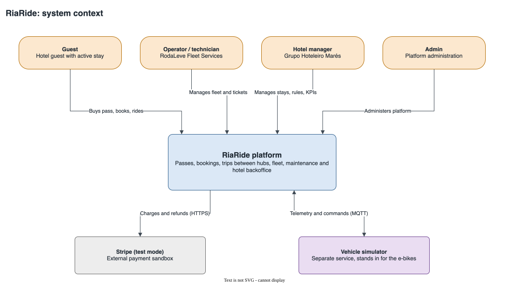
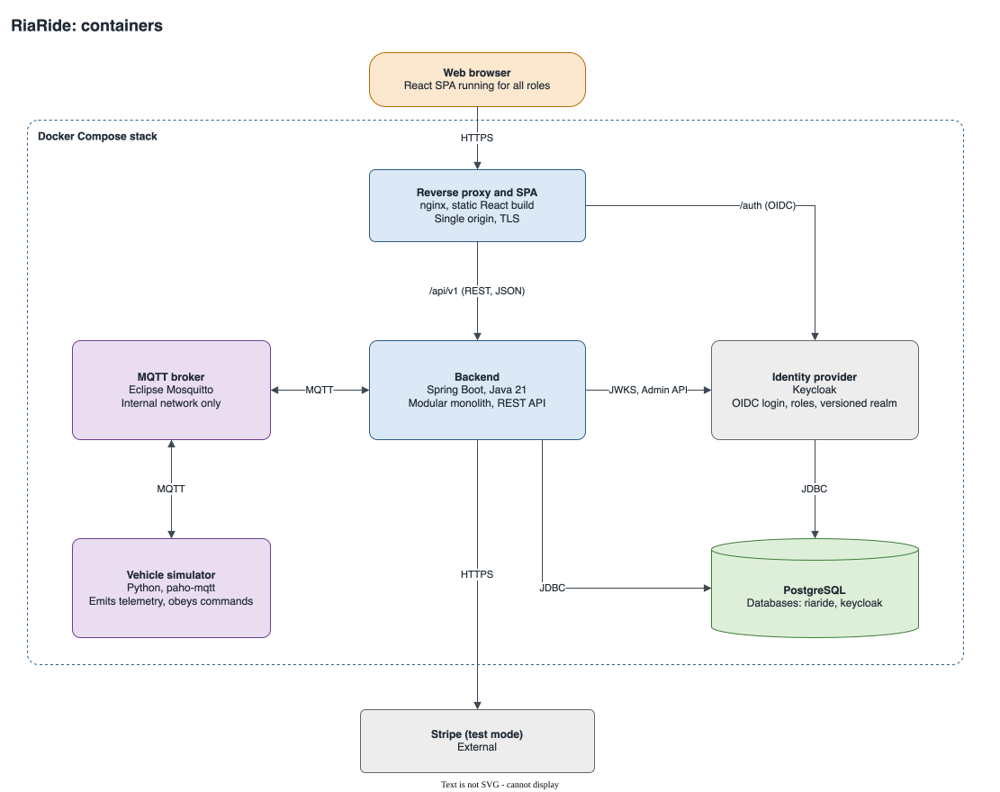
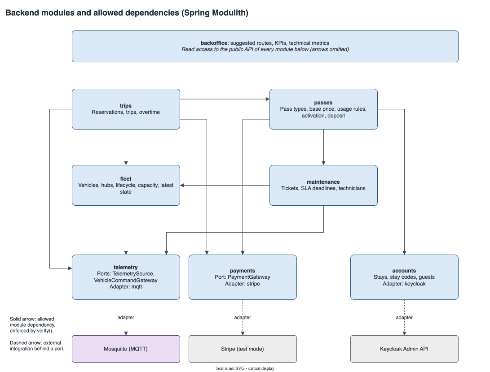
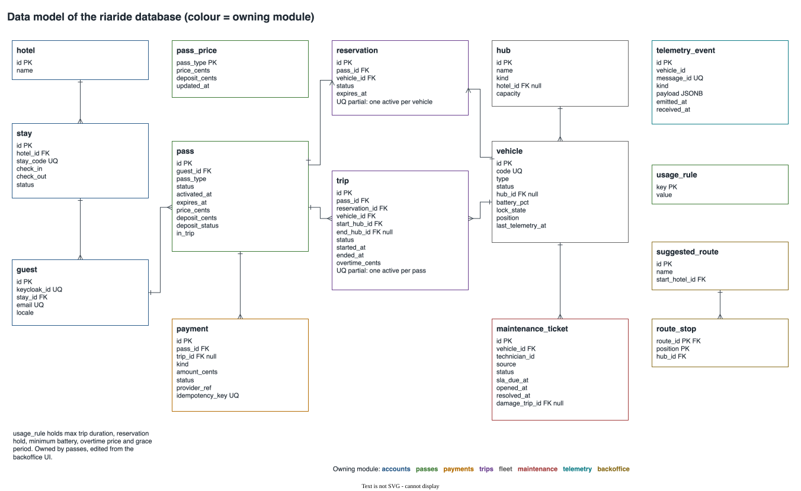
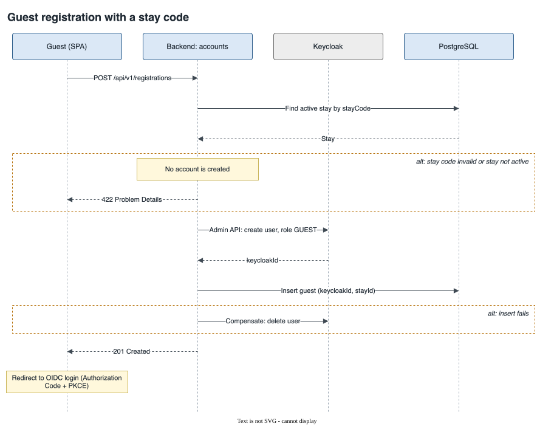
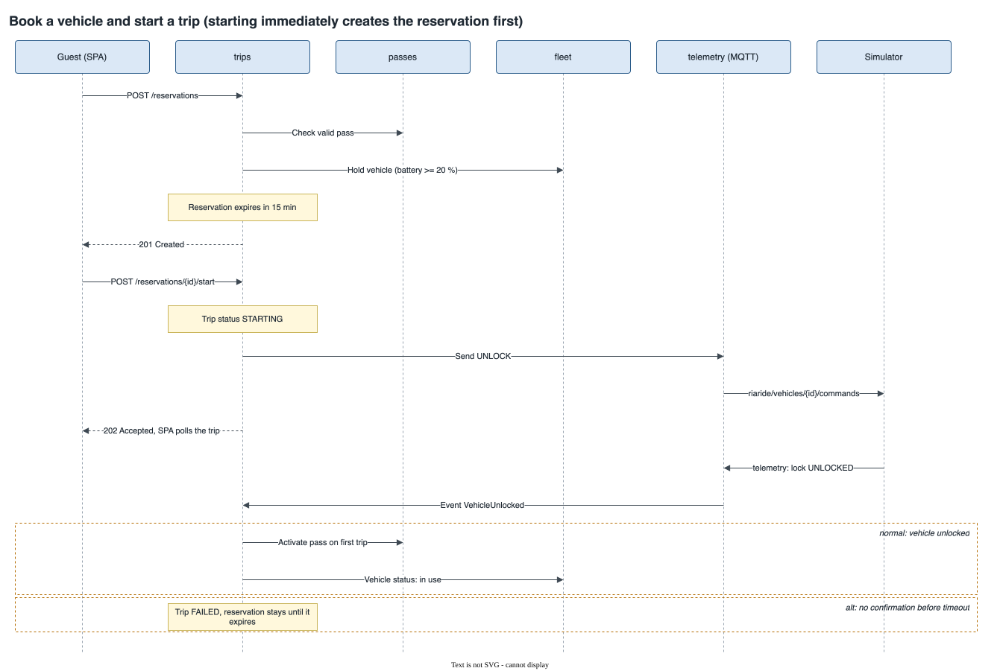
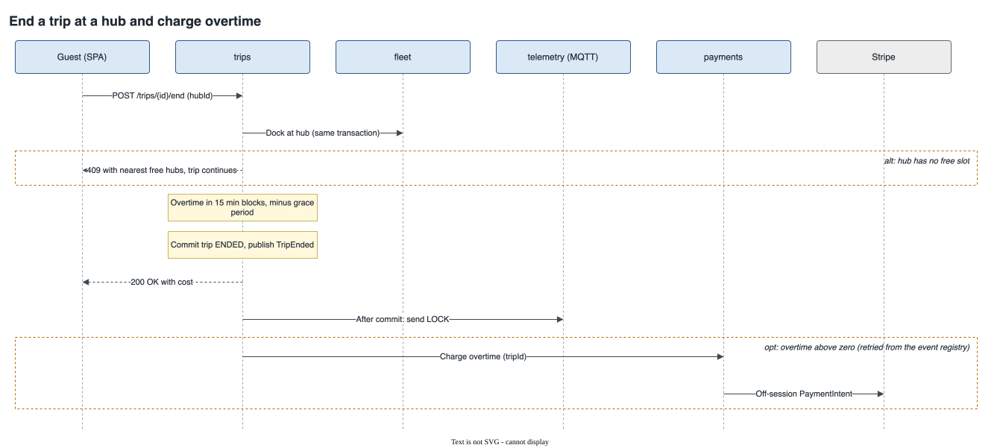
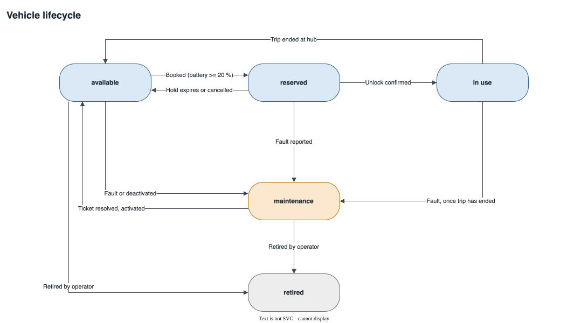
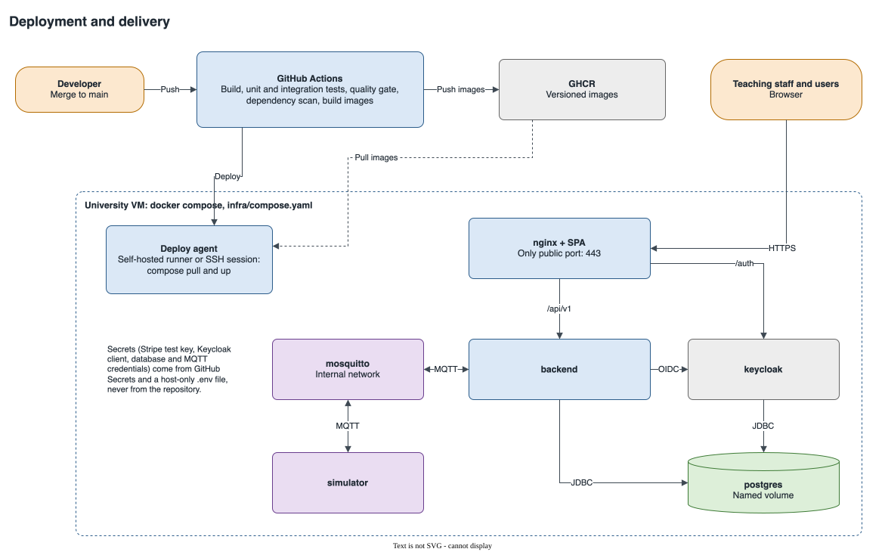

# RiaRide architecture proposal

**Status:** proposed for iteration I1, pending team review.

This document describes how RiaRide is built and why. Each significant choice has a short decision record in [`adr/`](adr/). The diagrams in [`diagrams/`](diagrams/) are `.drawio.svg` files: GitHub renders them, and draw.io opens them for editing.

## 1. Drivers

| Driver | Consequence for the architecture |
|---|---|
| Spring Boot and Java 21 are required | Backend stack is fixed |
| Simulator is a separate service, read through one interface behind an adapter | `telemetry` module exposes ports; only its adapter knows MQTT |
| Payments sit behind an adapter with integration tests | `payments` module exposes a port; only its adapter knows Stripe |
| Production is described as code and deployed from `main` | Docker Compose, images built in CI |
| The grade depends on evidence of quality | Boundaries, adapters and flows must be testable in isolation |
| Four people, five weeks | One deployable, few moving parts, parallel work per module |

## 2. Decisions

| # | Topic | Decision | Record |
|---|---|---|---|
| 1 | Style | Modular monolith, ports and adapters only at external integrations | [ADR 0001](adr/0001-modular-monolith.md) |
| 2 | Module boundaries | Spring Modulith, with `verify()` as a test and events persisted in PostgreSQL | [ADR 0002](adr/0002-spring-modulith.md) |
| 3 | Build | Maven with wrapper; Surefire, Failsafe, JaCoCo, SonarQube | [ADR 0003](adr/0003-maven.md) |
| 4 | Database | PostgreSQL only, Flyway migrations, Testcontainers | [ADR 0004](adr/0004-postgresql.md) |
| 5 | Frontend | React, Vite and TypeScript, react-i18next for Portuguese and English | [ADR 0005](adr/0005-react-frontend.md) |
| 6 | Vehicle integration | Bidirectional MQTT through Eclipse Mosquitto | [ADR 0006](adr/0006-mqtt-integration.md) |
| 7 | Simulator | Python with paho-mqtt, pytest and coverage reported to SonarQube | [ADR 0007](adr/0007-python-simulator.md) |
| 8 | Payments | Stripe test mode, confirmed server-side, WireMock in tests | [ADR 0008](adr/0008-stripe-test-mode.md) |
| 9 | Authentication | Keycloak OIDC: SPA with Authorization Code and PKCE, backend as resource server | [ADR 0009](adr/0009-keycloak.md) |
| 10 | Guest registration | Own form, backend validates the stay code, then Keycloak Admin API | [ADR 0010](adr/0010-registration-admin-api.md) |
| 11 | Deployment | Docker Compose on a university VM, images in GHCR, GitHub Actions | [ADR 0011](adr/0011-deployment.md) |
| 12 | Diagrams | draw.io stored as `.drawio.svg` | [ADR 0012](adr/0012-drawio-diagrams.md) |
| 13 | Pricing | One base price per pass type across the hotel chain | [ADR 0013](adr/0013-chain-base-price.md) |

## 3. System context



Guests, RodaLeve operators and technicians, Marés hotel managers and admins use one web application. Stripe test mode processes payments. The simulator stands in for the e-bikes.

## 4. Containers



| Container | Technology | Responsibility |
|---|---|---|
| Reverse proxy and SPA | nginx, static React build | Single public origin, TLS, routes `/api/v1` and `/auth` |
| Backend | Spring Boot, Java 21 | All business logic, REST API, OAuth2 resource server |
| PostgreSQL | One server, databases `riaride` and `keycloak` | Durable state |
| Keycloak | OIDC provider | Credentials, login pages, roles; realm exported to the repository |
| Mosquitto | MQTT broker | Telemetry and commands, internal network only |
| Simulator | Python, paho-mqtt | Emits telemetry per vehicle, reacts to commands |

Dashboards poll the REST API. A push channel is not justified by the MVP.

## 5. Backend modules



| Module | Responsibility | Depends on |
|---|---|---|
| `accounts` | Stays, stay codes, guests, link to Keycloak | none |
| `payments` | `PaymentGateway` port, Stripe adapter, charges and refunds | none |
| `telemetry` | `TelemetrySource` and `VehicleCommandGateway` ports, MQTT adapter, event history | none |
| `fleet` | Vehicles, hubs, lifecycle, hub capacity, latest vehicle state | `telemetry` |
| `maintenance` | Tickets, SLA deadlines, technician assignment | `fleet`, `telemetry` |
| `passes` | Pass types, base price, usage rules, activation, deposit | `accounts`, `payments`, `maintenance` |
| `trips` | Reservations, trips, overtime | `passes`, `fleet`, `telemetry`, `payments` |
| `backoffice` | Suggested routes, KPIs, technical metrics | read access to all of the above |

Only a module's top-level package is public. `ApplicationModules.of(...).verify()` runs as a test and fails the build on a cycle or a reach into another module's internals.

**Communication rule.** A module calls another module's public API for queries and for commands whose result it needs now. A module publishes an event for side effects elsewhere, handled by an `@ApplicationModuleListener` after commit. Spring Modulith stores each publication in PostgreSQL until its listener succeeds, so a crash does not lose a refund or an overtime charge.

| Event | Published by | Handled by | Effect |
|---|---|---|---|
| `VehicleTelemetryReceived` | `telemetry` | `fleet` | Updates latest vehicle state |
| `VehicleFaultDetected` | `telemetry` | `maintenance` | Opens a ticket with an SLA deadline |
| `VehicleUnlocked` | `telemetry` | `trips` | Confirms the trip start |
| `TripEnded` | `trips` | `trips` | Sends `LOCK`; charges overtime through `payments` |
| `DamageAttributed` | `maintenance` | `passes` | Withholds the deposit |

`passes` cannot depend on `trips`, because `trips` depends on `passes`. So `trips` tells `passes` when a trip starts and ends, through the `passes` public API, and `passes` keeps an `in_trip` flag. A pass that expires mid-trip is closed, and its deposit released, only once that flag is cleared.

## 6. Data model



Each table belongs to one module, and code in another module never accesses it directly. The rules with the highest concurrency risk are enforced by the database, not only in code:

| Rule | Mechanism |
|---|---|
| One vehicle in use per pass | Partial unique index on `trip (pass_id)` for active statuses |
| One active reservation per vehicle | Partial unique index on `reservation (vehicle_id)` for active statuses |
| Trip ends only at a hub with a free slot | Hub row locked, occupancy checked, trip ended, all in one transaction |
| No duplicate charge | Unique `payment.idempotency_key`, also sent to Stripe |
| No duplicate telemetry | Unique `telemetry_event.message_id` |

The base price lives in `pass_price`, one row per pass type. `pass` copies the amounts at purchase, so later price changes do not alter past passes. Thresholds live in `usage_rule`, owned by `passes` and edited from the backoffice UI: maximum trip duration (3 h), reservation hold (15 min), minimum battery (20 %), overtime price per 15 min, and `overtimeGraceMinutes` (0).

## 7. Key flows

### Registration



The stay-code rule stays in `accounts`, covered by our tests. If the local insert fails after Keycloak created the user, the backend deletes that user.

### Booking and starting a trip



Starting immediately creates a reservation first, so there is one code path. A scheduled job expires reservations; the database condition makes it safe to rerun. A trip stays `STARTING` until telemetry confirms the unlock. Without confirmation before the timeout, the trip is `FAILED`, the pass stays inactive, and the reservation remains until it expires.

### Ending a trip



Overtime is the time beyond the earliest of three limits: maximum trip duration, pass expiry, and check-out. It is rounded up to 15-minute blocks after the grace period. Charging happens after commit, so a Stripe outage does not block the guest from ending a trip. The event registry retries it.

## 8. Vehicle lifecycle



Battery below 20 % blocks booking without changing the status. A fault during a trip opens a ticket immediately, and the vehicle moves to `maintenance` when the trip ends.

## 9. Integration contracts

**MQTT.** Both directions use QoS 1, so consumers must tolerate duplicates.

| Topic | Direction | Content |
|---|---|---|
| `riaride/vehicles/{id}/telemetry` | Simulator to platform | Battery, position or hub, lock state |
| `riaride/vehicles/{id}/events` | Simulator to platform | Fault events |
| `riaride/vehicles/{id}/commands` | Platform to simulator | `UNLOCK`, `LOCK` |
| `riaride/simulator/status` | Simulator to platform | Retained status and last will, marks telemetry as stale |

```json
{
  "messageId": "6f1c2a10-52b4-4a8e-9a31-1f0f7a1d9c11",
  "emittedAt": "2026-11-20T10:15:30Z",
  "batteryPct": 74,
  "lockState": "UNLOCKED",
  "hubId": null,
  "position": { "lat": 40.64, "lon": -8.65 }
}
```

The consumer ignores a repeated `messageId` and any message older than the vehicle's last state. Replacing the simulator means replacing the adapter in `telemetry`, with no change to the ports or to other modules.

**Payments.** `PaymentGateway` offers charge and refund operations in domain terms, each with an idempotency key. The Stripe adapter confirms PaymentIntents server-side with test payment methods and charges overtime off-session against the saved method. The MVP needs no webhooks.

**REST.** Versioned under `/api/v1`, documented with OpenAPI, from which the frontend client is generated. Errors use RFC 9457 Problem Details.

## 10. Security

- The SPA uses Authorization Code with PKCE through keycloak-js and keeps tokens in memory. The backend validates JWTs against Keycloak's JWKS and authorizes by role.
- The only public port is 443. Mosquitto, PostgreSQL and the backend are reachable only inside the Compose network, and Mosquitto requires credentials.
- The Stripe test key, Keycloak client secret, and database and MQTT credentials live in GitHub Secrets and a host-only `.env` file.
- The password in the registration request is never stored by the backend or written to logs.
- Seed data is synthetic.

## 11. Testability

| Test type | Where it applies |
|---|---|
| Unit | Overtime calculation, pass rules, lifecycle transitions; pytest for the simulator |
| Module | `verify()` and `@ApplicationModuleTest` per module, including event flows |
| Integration (Failsafe) | API and persistence with Testcontainers; MQTT adapter against Mosquitto; Stripe adapter against WireMock; Keycloak adapter against a Keycloak container |
| BDD | Cucumber scenarios for core stories against the REST API |
| E2E | Playwright against the Compose stack, not on every build |
| Load | k6 on the book-and-start flow, against the SLOs in the Product Specification report |

Technical metrics come from Micrometer inside the backend, with no extra monitoring container. Telemetry lag is `received_at` minus `emitted_at`.

## 12. Deployment and delivery



A merge to `main` builds and tests in GitHub Actions, pushes versioned images to GHCR and updates the VM with `docker compose pull` and `up`. Migrations run when the backend starts. Representative data comes from a seed profile.

Planned repository layout:

```text
backend/    Maven project, one package per module
frontend/   React application
simulator/  Python service
infra/      compose.yaml, nginx, Mosquitto configuration, Keycloak realm export
docs/       Reports and this proposal
```

## 13. Risks and open questions

| Item | Impact | Owner |
|---|---|---|
| The original assignment was not reviewed for this proposal, only its summary in `CLAUDE.md` | A constraint may be missing | Team Coordinator |
| University VM availability, and whether it is reachable only from the internal network | Internal-only access requires a self-hosted runner; public reachability for the teaching staff must be confirmed | DevOps Master |
| Memory: the full stack is estimated at about 4 GB | Keycloak and the JVM may need limits | DevOps Master |
| Overtime grace period: the comment in the team document was resolved without changing the rule | Configured as 0 until confirmed | Product Owner |
| 3-day pass: assumed to last 72 h after activation | Rule to confirm | Product Owner |
| Whether 1-day and 3-day passes also end at check-out | Affects the overtime limit | Product Owner |
| Overtime price and deposit amount are undefined | Configurable, values needed for seed data | Product Owner |
| Epic 8 in the team document still mentions per-hotel prices | Contradicts decision 13 | Product Owner |
| Exact versions of Spring Boot, Spring Modulith and Keycloak | Pinned in the walking skeleton | DevOps Master |
