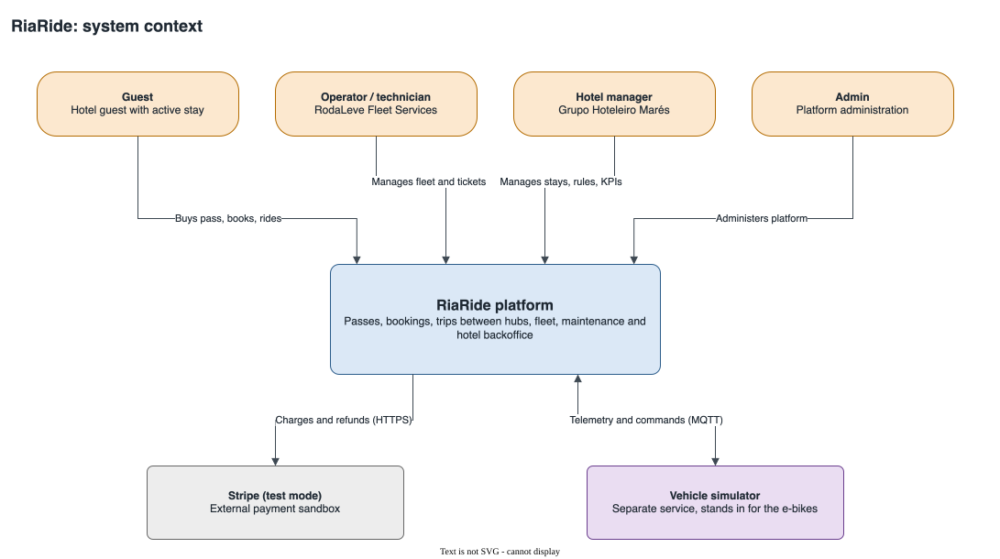
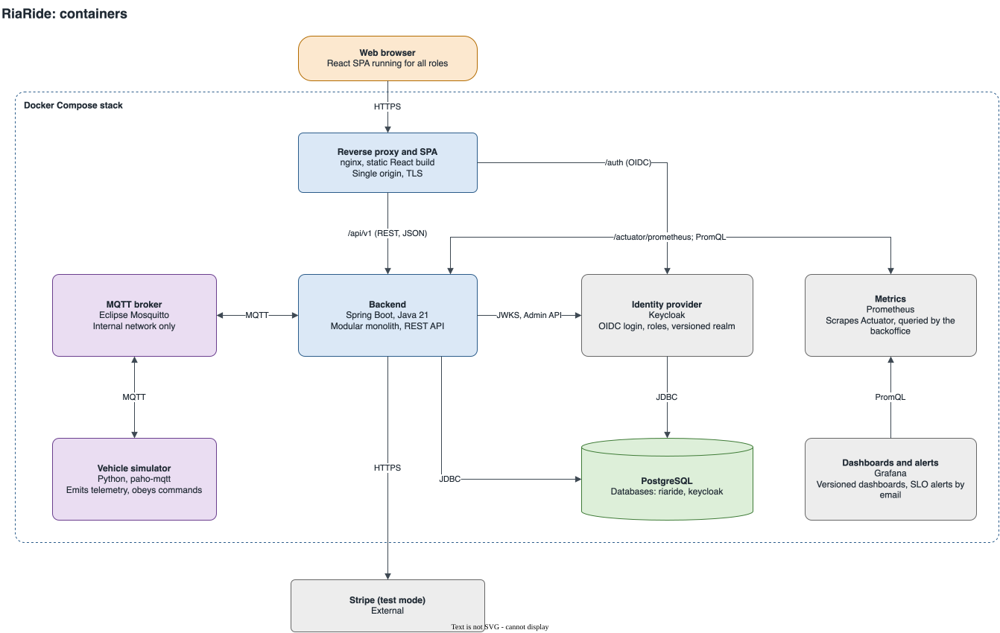
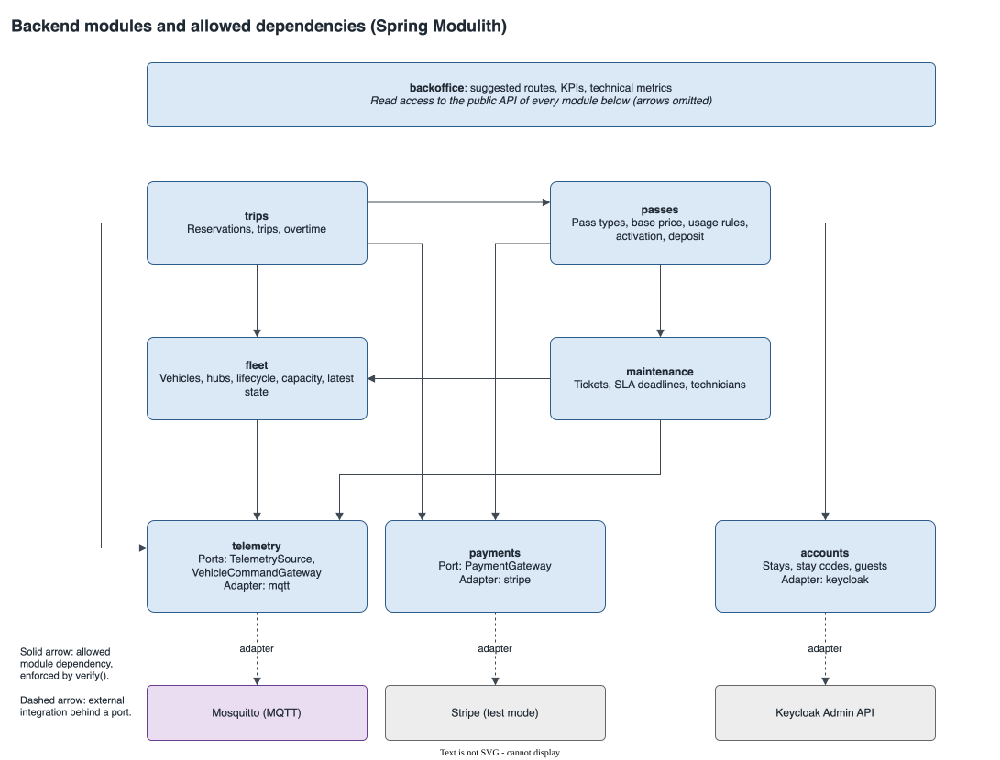
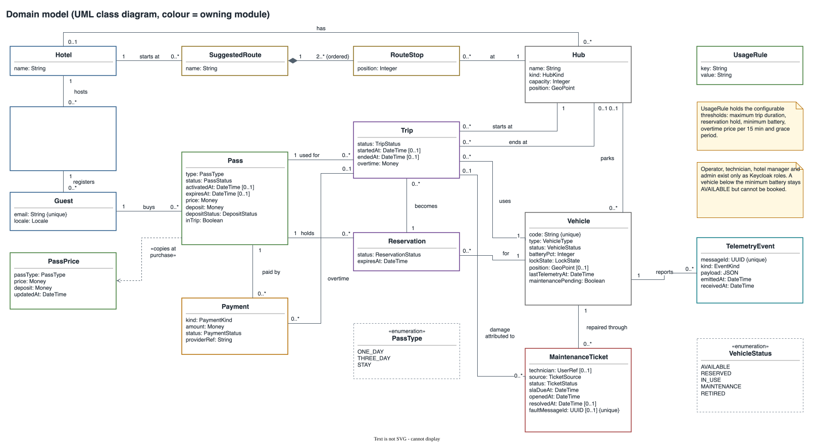
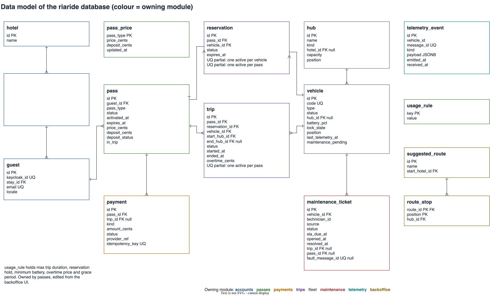
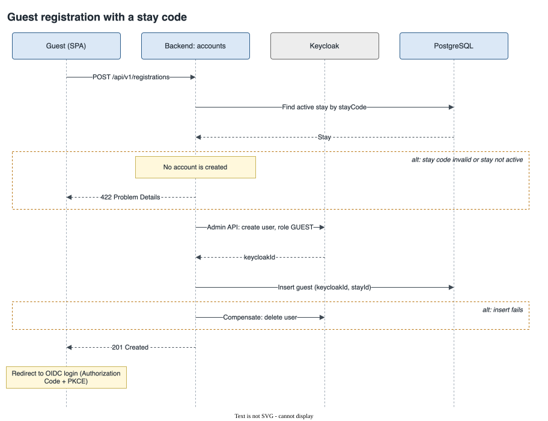
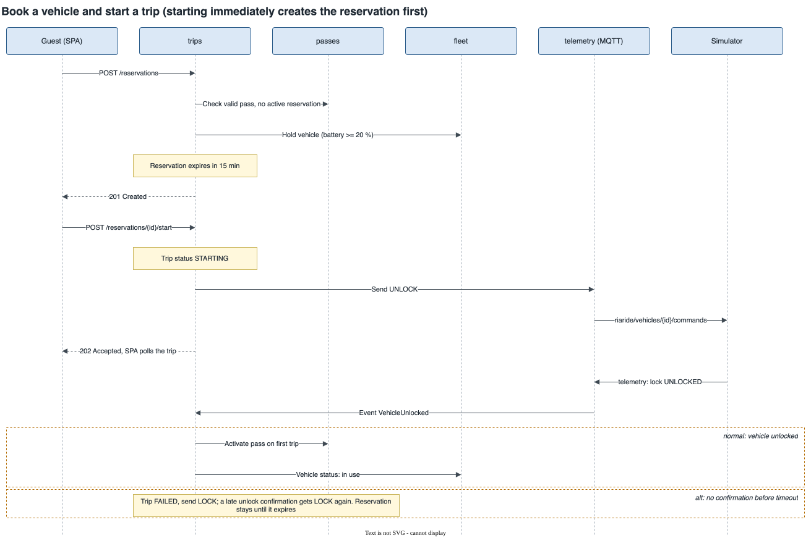
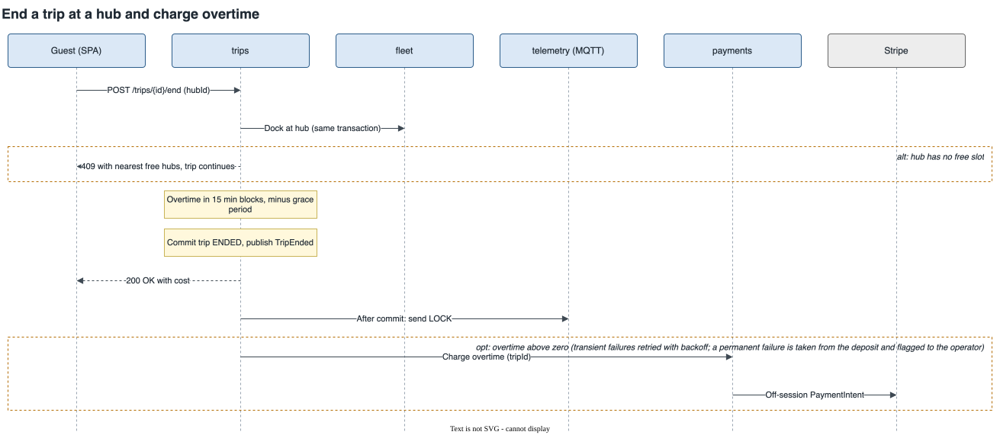
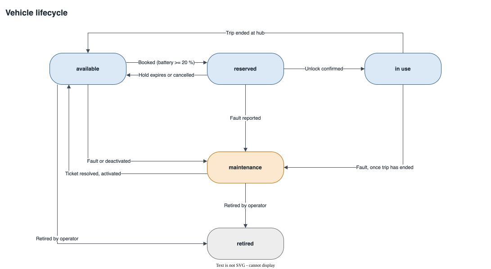
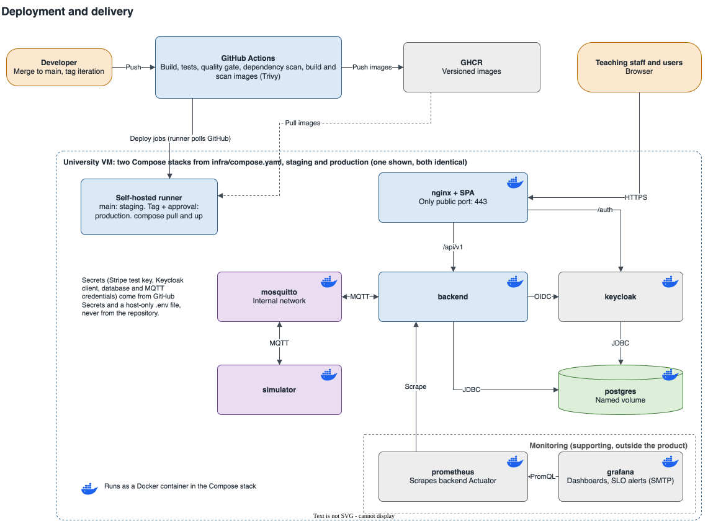

# RiaRide architecture proposal

**Status:** proposed for iteration I1, pending team review.

This document describes how RiaRide is built and why. Each significant choice has a short decision record in [`adr/`](adr/). The diagrams in [`diagrams/`](diagrams/) are `.drawio.svg` files: GitHub renders them, and draw.io opens them for editing.

## 1. Drivers

| Driver | Consequence for the architecture |
|---|---|
| Spring Boot and Java 21 are required | Backend stack is fixed |
| Simulator is a separate service, read through one interface behind an adapter | `telemetry` module exposes ports; only its adapter knows MQTT |
| Payments sit behind an adapter with integration tests | `payments` module exposes a port; only its adapter knows Stripe |
| Production is described as code and deployed from `main` | Docker Compose, images built in CI |
| The grade depends on evidence of quality | Boundaries, adapters and flows must be testable in isolation |
| Four people, five weeks | One deployable, few moving parts, parallel work per module |

### Traceability to the assignment

Each requirement of the assignment guidelines (v2026-11-10) that shapes the architecture, and where this proposal answers it.

| Requirement | Guidelines | Where it is answered |
|---|---|---|
| Spring Boot (stable) and Java 21 | 1.2 | Decisions 1 to 3, section 5 |
| Web UI; end-to-end tests with Selenium or Playwright | 1.2, T4 | [ADR 0005](adr/0005-react-frontend.md), [ADR 0014](adr/0014-sqa-tools.md) |
| Deployment on a department VM or a cloud provider, reachable by the teaching staff | 1.2 | [ADR 0011](adr/0011-deployment.md), section 12; reachability is an open risk (section 13) |
| Find vehicles by hub and type; book or start immediately; end at a hub; user dashboard | 4.1 | `fleet` and `trips`, section 7. Booking for a period is an open question (section 13) |
| Register vehicles and hubs; lifecycle with activation and deactivation; tickets with an SLA deadline assigned to a technician; operator dashboard | 4.1 | `fleet` and `maintenance`, section 8 |
| Rules of use (maximum duration, hub capacity); business KPIs; technical metrics | 4.1 | `usage_rule`, `backoffice`, Micrometer and Prometheus (section 11). Restricting who may use which vehicles is an open question (section 13) |
| Registration, authentication, role-based access | 4.1 | [ADR 0009](adr/0009-keycloak.md), [ADR 0010](adr/0010-registration-admin-api.md) |
| Deposit and overtime in a payment sandbox | 4.1 | [ADR 0008](adr/0008-stripe-test-mode.md), section 9 |
| Telemetry reflected in vehicle state; low battery blocks booking | 4.1 | `telemetry` and `fleet`, section 8 |
| Simulator in its own container, read through one interface; replacing it changes only the adapter | 4.4 | [ADR 0006](adr/0006-mqtt-integration.md), [ADR 0007](adr/0007-python-simulator.md), section 9 |
| End users report problems | 3.2 | Open question (section 13) |
| Feature branch per story, protected `main`, merges through pull requests | D1 | Working rules in `CLAUDE.md`; `main` is not protected yet (section 13) |
| CI on every push and pull request, with a blocking quality gate | D2, Q1, Q2 | Section 12, [ADR 0014](adr/0014-sqa-tools.md) |
| Production described as code; `main` deploys automatically with representative data | D3, D4 | [ADR 0011](adr/0011-deployment.md), section 12 |
| Dependency vulnerability scanning on every build | Q3 | [ADR 0014](adr/0014-sqa-tools.md) |
| Integration tests separate from unit tests | T3 | [ADR 0003](adr/0003-maven.md), section 11 |
| SLOs checked by a k6 load test with thresholds | T5 | Section 11; the SLOs belong in the Product Specification report |
| Observability: dashboards and alerts on SLOs (valued) | D6 | Prometheus and Grafana, section 11 |

## 2. Decisions

| # | Topic | Decision | Record |
|---|---|---|---|
| 1 | Style | Modular monolith, ports and adapters only at external integrations | [ADR 0001](adr/0001-modular-monolith.md) |
| 2 | Module boundaries | Spring Modulith, with `verify()` as a test and events persisted in PostgreSQL | [ADR 0002](adr/0002-spring-modulith.md) |
| 3 | Build | Maven with wrapper; Surefire, Failsafe, JaCoCo, SonarQube | [ADR 0003](adr/0003-maven.md) |
| 4 | Database | PostgreSQL only, Flyway migrations, Testcontainers | [ADR 0004](adr/0004-postgresql.md) |
| 5 | Frontend | React, Vite and TypeScript, react-i18next for Portuguese and English | [ADR 0005](adr/0005-react-frontend.md) |
| 6 | Vehicle integration | Bidirectional MQTT through Eclipse Mosquitto | [ADR 0006](adr/0006-mqtt-integration.md) |
| 7 | Simulator | Python with paho-mqtt, pytest and coverage reported to SonarQube | [ADR 0007](adr/0007-python-simulator.md) |
| 8 | Payments | Stripe test mode, confirmed server-side, WireMock in tests | [ADR 0008](adr/0008-stripe-test-mode.md) |
| 9 | Authentication | Keycloak OIDC: SPA with Authorization Code and PKCE, backend as resource server | [ADR 0009](adr/0009-keycloak.md) |
| 10 | Guest registration | Own form, backend validates the stay code, then Keycloak Admin API | [ADR 0010](adr/0010-registration-admin-api.md) |
| 11 | Deployment | Staging and production Compose stacks on a university VM, images in GHCR, deploys through a self-hosted runner, promotion on iteration tags | [ADR 0011](adr/0011-deployment.md) |
| 12 | Diagrams | draw.io stored as `.drawio.svg` | [ADR 0012](adr/0012-drawio-diagrams.md) |
| 13 | Pricing | One base price per pass type across the hotel chain | [ADR 0013](adr/0013-chain-base-price.md) |
| 14 | SQA tools | SonarQube Cloud (OSS plan), JaCoCo, Cucumber, Playwright, k6, Xray and per-stack dependency scanning | [ADR 0014](adr/0014-sqa-tools.md) |

## 3. System context



Guests, RodaLeve operators and technicians, Marés hotel managers and admins use one web application. Stripe test mode processes payments. The simulator stands in for the e-bikes.

## 4. Containers



Every box with the Docker icon is one service in `infra/compose.yaml` and runs as its own container. The web browser and Stripe are not containers.

**RiaRide system**

| Container | Technology | Responsibility |
|---|---|---|
| Reverse proxy and SPA | nginx, static React build | Single public origin, TLS, routes `/api/v1`, `/auth` and `/grafana` |
| Backend | Spring Boot, Java 21 | All business logic, REST API, OAuth2 resource server (components in section 5) |
| PostgreSQL | One server, databases `riaride` and `keycloak` | Durable state |
| Keycloak | OIDC provider | Credentials, login pages, roles; realm exported to the repository |
| Mosquitto | MQTT broker | Telemetry and commands, internal network only |
| Simulator | Python, paho-mqtt | Stands in for the e-bikes: emits telemetry per vehicle, reacts to commands |

**Monitoring (supporting)**

| Container | Technology | Responsibility |
|---|---|---|
| Prometheus | Metrics store | Scrapes the backend's Actuator endpoint; queried by the backoffice for technical metrics |
| Grafana | Dashboards and alerts | Versioned dashboards, SLO alert rules sent by email |

Prometheus and Grafana run in the same Compose project but sit outside the system boundary: they observe and operate RiaRide, and no guest, operator or hotel flow depends on them. If Prometheus is down, the backoffice shows the technical metrics as unavailable and every other feature keeps working. Dashed arrows in the diagram are monitoring traffic.

Dashboards poll the REST API. A push channel is not justified by the MVP.

## 5. Backend modules



| Module | Responsibility | Depends on |
|---|---|---|
| `accounts` | Stays, stay codes, guests, link to Keycloak | none |
| `payments` | `PaymentGateway` port, Stripe adapter, charges and refunds | none |
| `telemetry` | `TelemetrySource` and `VehicleCommandGateway` ports, MQTT adapter, event history | none |
| `fleet` | Vehicles, hubs, lifecycle, hub capacity, latest vehicle state | `accounts` (`HotelDirectory`, to link a hub to its hotel), `telemetry` |
| `maintenance` | Tickets, SLA deadlines, technician assignment | `fleet`, `telemetry` |
| `passes` | Pass types, base price, usage rules, activation, deposit | `accounts`, `payments`, `maintenance` |
| `trips` | Reservations, trips, overtime | `passes`, `fleet`, `maintenance`, `telemetry`, `payments` |
| `backoffice` | Suggested routes, KPIs, technical metrics | read access to all of the above |

The Java code of a module reaches another module only through its public API, but some tables keep a database foreign key across modules for integrity: `hub.hotel_id` (fleet) references `hotel.id` (accounts). Changing or dropping a referenced table therefore needs a migration in the referencing module too.

Only a module's top-level package is public. `ApplicationModules.of(...).verify()` runs as a test and fails the build on a cycle or a reach into another module's internals.

### Components inside the backend


Requests enter through the REST controllers, protected by Spring Security, and reach the business modules. Modules reach the outside only through the JPA repositories and the three adapters (Keycloak, MQTT, Stripe). Inside, every module has the same four layers:

| Layer | Package | Responsibility |
|---|---|---|
| Controller | `<module>.internal.web` | Receives the request, validates input, maps DTOs |
| Service | `<module>.internal.application` | Runs the use case in a transaction, publishes events |
| Domain | `<module>.internal.domain` | Business rules, with time from an injected `Clock` |
| Repository | `<module>.internal.persistence` | Spring Data JPA over the module's own tables |

Only the module's top-level package (its API, events and DTOs) is public. Event listeners and scheduled jobs sit in `internal` too.

**Communication rule.** A module calls another module's public API for queries and for commands whose result it needs now. A module publishes an event for side effects elsewhere, handled by an `@ApplicationModuleListener` after commit. Spring Modulith stores each publication in PostgreSQL until its listener succeeds, so a crash does not lose a refund or an overtime charge.

*Exception:* `fleet` handles `VehicleTelemetryReceived` with a synchronous `@EventListener` in the MQTT adapter's transaction. The broker's QoS 1 delivery is the durable queue here: the message is acknowledged only after the reading is stored, so an after-commit listener would add nothing but a window in which an acknowledged reading is lost.

| Event | Published by | Handled by | Effect |
|---|---|---|---|
| `VehicleTelemetryReceived` | `telemetry` | `fleet` | Updates latest vehicle state |
| `VehicleFaultDetected` | `telemetry` | `maintenance`, `fleet`, `trips` | Opens a ticket with an SLA deadline; takes the vehicle out of service; cancels its reservation or links its trip to the ticket |
| `VehicleUnlocked` | `telemetry` | `trips` | Confirms the trip start; for a trip already `FAILED`, sends `LOCK` again |
| `TripEnded` | `trips` | `trips` | Sends `LOCK` at the hub the trip ended at (RIA-55); charges overtime through `payments`, or takes it from the deposit if the charge fails permanently (story 2.3) |
| `TicketResolved` | `maintenance` | `passes` | Carries the linked pass, if any, and whether the damage was attributed to the guest. Withholds the deposit, or lets it be refunded |

`passes` cannot depend on `trips`, because `trips` depends on `passes`. So `trips` tells `passes` when a trip starts, when it ends and when it is settled, through the `passes` public API. A pass that ends (expiry or check-out) during a trip stays `ACTIVE`, so the trip continues (BR8, BR9). The trip's end closes it, in the same transaction, after the trip row is locked (RIA-89). A pass that ends with no trip in progress, or a paid pass never used once the stay has ended, is closed by `EndedPassClosingJob` in `trips`, every minute, so the guest can buy another: a guest holds one open pass at a time. Closing does not refund the deposit: it stays `HELD` until every trip of the pass is settled **and** `maintenance` reports no open ticket linked to the pass. A trip is settled once it has ended and its overtime, if any, is paid or taken from the deposit (section 7), so the deposit cannot be refunded while an overtime charge is still pending. Each settled trip and each `TicketResolved` for the pass make `passes` check again (RIA-114).

**Faults.** Three modules react to `VehicleFaultDetected`, each in its own data:

- `maintenance` opens one ticket per fault, identified by the event's `messageId`, so a repeated message opens no second ticket.
- `fleet` moves an `available` or `reserved` vehicle to `maintenance`. A vehicle `in use` keeps its status and is flagged `maintenancePending`; when the trip ends at a hub, `fleet` moves it to `maintenance` instead of `available`.
- `trips` cancels an active reservation for the vehicle. If a trip is in progress, the trip continues, and `trips` attaches the trip and its pass to the ticket through the `maintenance` public API. The call carries the fault's `messageId`, so it works whichever listener runs first.

When a technician resolves the ticket, `maintenance` publishes `TicketResolved` with the pass and whether the damage was attributed to the guest. If it was, `passes` withholds the deposit; if not, the deposit is refunded once no other ticket is open. Holding the refund while a ticket is open means a technician who attributes damage days later still finds the deposit there. `maintenance` cannot look up the trip itself: depending on `trips` would close the cycle `trips` → `passes` → `maintenance`.

## 6. Domain and data model

### Domain model



The UML class diagram shows the business concepts and their associations, independent of tables and keys. Border colour shows the owning module. A reservation can lead to several trips, because a trip that fails to start leaves the reservation active until it expires. A pass copies its price and deposit from `PassPrice` at purchase.

### Data model



Each table belongs to one module, and code in another module never accesses it directly. The rules with the highest concurrency risk are enforced by the database, not only in code:

| Rule | Mechanism |
|---|---|
| One vehicle in use per pass | Partial unique index on `trip (pass_id)` for active statuses |
| One active reservation per vehicle | Partial unique index on `reservation (vehicle_id)` for active statuses |
| One active reservation per pass | Partial unique index on `reservation (pass_id)` for active statuses |
| Trip ends only at a hub with a free slot | Hub row locked, occupancy checked, trip ended, all in one transaction |
| No duplicate charge | Unique `payment.idempotency_key`, also sent to Stripe |
| No duplicate telemetry | Unique `telemetry_event.message_id` |
| One ticket per reported fault | Unique `maintenance_ticket.fault_message_id` |

The base price lives in `pass_price`, one row per pass type. `pass` copies the amounts at purchase, so later price changes do not alter past passes. Thresholds live in `usage_rule`, owned by `passes` and edited from the backoffice UI: maximum trip duration (3 h), reservation hold (15 min), minimum battery (20 %), overtime price per 15 min, and `overtimeGraceMinutes` (0).

## 7. Key flows

### Registration



The stay-code rule stays in `accounts`, covered by our tests. If the local insert fails after Keycloak created the user, the backend deletes that user.

### Booking and starting a trip



Starting immediately creates a reservation first, so there is one code path. A scheduled job expires reservations; the database condition makes it safe to rerun. A trip stays `STARTING` until telemetry confirms the unlock. Without confirmation before the timeout, the trip is `FAILED`, `trips` sends `LOCK` in case the vehicle did unlock, the pass stays inactive, and the reservation remains until it expires. If a `VehicleUnlocked` arrives later for that `FAILED` trip, `trips` sends `LOCK` again, so a vehicle is never left unlocked with no trip recorded. Because a pass holds at most one active reservation, the guest can retry on the same reservation or cancel it.

*Implemented so far (RIA-54):* `POST /api/v1/trips` starts a trip now and answers `202` with the trip's `Location`; `GET /api/v1/trips/{id}` lets the guest follow it from `STARTING` to `IN_USE` or `FAILED`. The rules it settles:

- **The 30-second boundary.** A trip still `STARTING` exactly 30 s after the request has failed: at 29 s it is starting, at 30 s and 31 s it is `FAILED` (BR13, `riaride.trips.unlock-timeout`). The timeout counts when the platform handles the `UNLOCKED` reading, not when the vehicle emitted it, so a reading delayed past 30 s fails the trip and sends `LOCK` instead of starting it. `UnlockTimeoutJob` fails overdue starts every 5 s, each in its own transaction, under the trip's row lock, so it never races the unlock confirmation.
- **Retry after a failed start.** The failed trip leaves the reservation `ACTIVE` and the bike `RESERVED` (15 minutes, BR11). A retry on the same bike reuses that reservation without asking `fleet` again; another bike is refused (`409 Reservation held for another bike`) while the reservation is held. At `expires_at` the reservation becomes `EXPIRED` and the bike `AVAILABLE` again: `ReservationExpiryJob` does it every 30 s (skipping a reservation whose trip is still `STARTING`), and the guest's next start does it at once. A confirmed unlock whose bike is no longer `RESERVED`, or whose pass can no longer take a trip, fails the trip and sends `LOCK` instead of starting it. Bike codes are matched regardless of case.
- **`UNLOCK` after commit.** `UNLOCK` and `LOCK` are sent only after the transaction that decided them commits, so the simulator's answer can never arrive before the trip is stored, and a rolled-back start never unlocks a bike. Sending waits at most 2 s for the broker's acknowledgement and never fails the request: a lost `UNLOCK` makes the trip time out.
- **Telemetry from before the request is ignored.** An `UNLOCKED` reading emitted more than one minute (the allowed clock skew) before the trip was requested, such as a redelivered QoS 1 message, does not confirm it. A repeated `UNLOCKED` for a trip in use changes nothing, so the pass is activated once (BR4).
- **Pass expiry.** The confirmed unlock of the first trip activates the pass and sets `expires_at`: 24 h later for a 1-day pass, 72 h for a 3-day pass, but never after the end of the stay, which is also when a stay pass ends. The stay ends at midnight after the check-out day in Vila Ria; the pass stores it as `stay_ends_at` at purchase (Product Owner decisions, RIA-87). A pass that was never used cannot start a trip after that time either.
- **Concurrent starts.** The database allows one active reservation per bike and per pass and one trip in progress per pass (partial unique indexes), and the vehicle row is locked while it is reserved, so of two parallel starts exactly one succeeds and the other gets a `409` problem detail. Telemetry locks the vehicle row too, so a battery reading cannot write back a status that a start has just changed.

### Ending a trip



A hub without a free slot rejects the end of the trip. The response lists the nearest hubs that have a free slot, ordered by straight-line distance from the hub's `position`, and the trip continues.

*Implemented so far (RIA-55):* `POST /api/v1/trips/{id}/end` with a `hubId` ends the guest's trip in use and answers `200` with the trip `ENDED`, its `endedAt` and its `endHubId`. The rules it settles:

- **Free slot (BR10).** The hub takes the bike while its docked bikes are fewer than its capacity. A full hub answers `409 Hub full`, the trip stays `IN_USE` and the bike stays in use. The problem detail's `nearbyHubs` member lists at most three other hubs with a free slot, nearest first by great-circle (haversine) distance from the full hub, each with its `hubId`, `name`, `freeSlots` and `distanceMeters`. Those suggestions are read without locks; the guest's next request checks the chosen hub again.
- **Locks.** `fleet` locks the vehicle row and then the hub row, and `trips` then locks the trip row. Telemetry locks the vehicle before the trip too, so a reading of the same bike never deadlocks with the end, and two ends at a hub with one free slot take it one after the other: one gets `200`, the other `409`.
- **Who and when.** Only the guest's own trip is found (`404 Trip not found` otherwise), and only a trip `IN_USE` ends (`409 Trip not in progress` for one starting, failed or already ended). The guest can end it after the stay has ended, since a bike still out at check-out has to come back (BR9).
- **`LOCK` after commit.** The bike is docked `AVAILABLE` at the hub in the same transaction, and `LOCK` with that `hubId` is sent once it commits. An `UNLOCKED` reading sent during the ride and handled after the end changes nothing.
- **Not yet.** Telling `passes` that the trip is settled comes with the deposit refund (RIA-114).

*Implemented so far (RIA-88):* once the end commits, `OvertimeChargeListener` (an `@ApplicationModuleListener`) computes the overtime from the trip's start and end and the pass's `expires_at` and `stay_ends_at`, and `payments` charges it off-session to the card saved with the purchase, with the idempotency key `trip-<id>:overtime`. The charge is recorded as a `payment` row of kind `OVERTIME`, `SUCCEEDED` or, when refused for good, `FAILED` without a provider reference. The price, the grace period and the 3 h limit are in `riaride.trips.overtime`. Only `@ApplicationModuleListener` listeners are kept in the event publication registry (`spring.modulith.events.registry-trigger-annotation`, table `event_publication`), so the bike commands are never resent. The listener runs outside a transaction, so the call to Stripe holds no database connection. `OvertimeRetryJob` resubmits overtime charges that failed for now after 1, 2, 4 and 8 minutes, up to 5 attempts. When the last attempt fails too, the charge is recorded as a `FAILED` payment and its publication is deleted, since Spring Modulith reads failed publications oldest first and exhausted ones would crowd out newer charges. A publication left published or processing by a crash or restart is marked failed after 5 minutes (`spring.modulith.events.staleness`), and a completed one is deleted (`completion-mode: delete`). Taking a refused or abandoned charge from the deposit, and showing it on the operator dashboard, come with RIA-114.

Overtime is the time beyond the earliest of three limits: maximum trip duration, pass expiry, and check-out. The time beyond the grace period is charged per started 15-minute block: 2.00 EUR per block, with no grace period (Product Owner decisions, RIA-88), so 3 h 20 min is 2 blocks. Charging happens after commit, so a Stripe outage does not block the guest from ending a trip.

The `PaymentGateway` port reports a failed charge as transient (network error, Stripe 5xx, rate limit) or permanent (card declined, `authentication_required`). Spring Modulith keeps a failed publication as incomplete but does not retry it on its own, so a scheduled job in `trips` resubmits incomplete overtime publications with backoff, up to a maximum number of attempts. A permanent failure, or the last failed attempt, is final: the `payment` row is `FAILED`, `trips` asks `passes` to take the overtime from the deposit, which is still held because the trip is not settled yet, and the case appears on the operator dashboard. Only then is the trip settled.

## 8. Vehicle lifecycle



Battery below 20 % blocks booking without changing the status. A fault during a trip opens a ticket immediately, and the vehicle moves to `maintenance` when the trip ends (see **Faults** in section 5).

## 9. Integration contracts

**MQTT.** Both directions use QoS 1, so consumers must tolerate duplicates.

| Topic | Direction | Content |
|---|---|---|
| `riaride/vehicles/{id}/telemetry` | Simulator to platform | Battery, position or hub, lock state |
| `riaride/vehicles/{id}/events` | Simulator to platform | Fault events |
| `riaride/vehicles/{id}/commands` | Platform to simulator | `UNLOCK`, `LOCK` |
| `riaride/simulator/status` | Simulator to platform | Retained status and last will, marks telemetry as stale |

```json
{
  "messageId": "6f1c2a10-52b4-4a8e-9a31-1f0f7a1d9c11",
  "emittedAt": "2026-11-20T10:15:30Z",
  "batteryPct": 74,
  "lockState": "UNLOCKED",
  "hubId": null,
  "position": { "lat": 40.64, "lon": -8.65 }
}
```

The consumer ignores a repeated `messageId` on both topics. Only telemetry is also checked for staleness: a telemetry message older than the vehicle's last state is ignored. Fault events are never dropped as stale, because MQTT does not order messages across topics, so a fault can arrive after a later telemetry message. Replacing the simulator means replacing the adapter in `telemetry`, with no change to the ports or to other modules.

The message formats are the JSON Schemas in [`contracts/mqtt/`](../../contracts/mqtt/), shared by the simulator and the backend adapter (RIA-58). Agreed for both sides:

- `{id}` in the topics is the vehicle code (`vehicle.code`, for example `EB-101`), not the platform's vehicle id: the code is what an operator registers and what the simulator knows.
- `hubId` is the platform's hub id, so the simulator's demo fleet uses the same hub ids as the platform's seed data.
- `hubId` is optional on `LOCK`. Without it, or with a hub the simulator does not know, the vehicle locks where it is and its telemetry reports `hubId: null`.
- Every command carries `emittedAt`. The simulator ignores a command older than 30 s, the unlock timeout (BR13), so an `UNLOCK` the platform already gave up on is not applied when the simulator reconnects and the broker delivers the commands it kept.

*Implemented so far (RIA-59):* the MQTT adapter (`telemetry.internal.mqtt`) subscribes to `riaride/vehicles/+/telemetry` with QoS 1 and a kept session, maps each message to `VehicleTelemetryReceived` and publishes it in one transaction; `fleet` stores the battery reading, and `GET /api/v1/hubs/{hubId}/vehicles` marks each vehicle `bookable` by BR12 without changing its status. A reading older than the vehicle's last one, or more than a minute ahead of the server clock, is ignored. The subscription runs off Paho's callback thread, so the backlog the broker sends on reconnection cannot block it. A message that is not a valid reading, or whose handling fails, is logged without its payload and dropped, so it is never redelivered in a loop. The simulator's tests already validate its messages against the schemas; deduplication by `messageId`, the backend adapter's JSON Schema contract tests and the hub, position and lock-state updates come with [RIA-58](https://riaride.atlassian.net/browse/RIA-58). The backend connects with `MQTT_URL`, `MQTT_USERNAME` and `MQTT_PASSWORD`; in production the broker must require credentials, use TLS on any network other than the internal one, and limit the backend's ACLs to subscribing to `riaride/vehicles/+/telemetry` and publishing to `riaride/vehicles/+/commands` (RIA-54).

**Payments.** `PaymentGateway` offers charge and refund operations in domain terms, each with an idempotency key. The Stripe adapter confirms PaymentIntents server-side with test payment methods. At purchase it creates a Stripe Customer and confirms the PaymentIntent with `setup_future_usage=off_session`, which saves the payment method. Overtime is charged off-session to that Customer and payment method, which the adapter reads from the purchase payment's `provider_ref`, so no other module stores Stripe identifiers. The MVP needs no webhooks.

**REST.** Versioned under `/api/v1`, documented with OpenAPI, from which the frontend client is generated. Errors use RFC 9457 Problem Details. Request bodies are strict for the whole API: a JSON number with a fraction in a whole-number field is rejected with a 400 (`spring.jackson.deserialization.accept-float-as-int: false`), so `1.5` and `1.0` are both refused instead of being truncated. A number for an enum field is also a 400 (`spring.jackson.datatype.enum.fail-on-numbers-for-enums: true`), instead of being read as the enum's ordinal.

## 10. Security

- The SPA uses Authorization Code with PKCE through keycloak-js and keeps tokens in memory. The backend validates JWTs against Keycloak's JWKS and authorizes by role.
- The only public port is 443. Mosquitto, PostgreSQL, Prometheus and the backend are reachable only inside the Compose network, and Mosquitto requires credentials. Grafana is reached only through nginx, with its own login.
- The Stripe test key, Keycloak client secret, and database and MQTT credentials live in GitHub Secrets and a host-only `.env` file.
- The password in the registration request is never stored by the backend or written to logs.
- Seed data is synthetic.

## 11. Testability

| Test type | Where it applies |
|---|---|
| Unit | Overtime calculation, pass rules, lifecycle transitions; pytest for the simulator |
| Module | `verify()` and `@ApplicationModuleTest` per module, including event flows |
| Integration (Failsafe) | API and persistence with Testcontainers; MQTT adapter against Mosquitto; Stripe adapter against WireMock; Keycloak adapter against a Keycloak container |
| BDD | Cucumber scenarios for core stories against the REST API |
| E2E | Playwright against the Compose stack, not on every build |
| Load | k6 on the book-and-start flow, against the SLOs in the Product Specification report |

Technical metrics follow the QA Manual (section 4.3). Spring Boot Actuator and Micrometer expose them in Prometheus format: API latency and error rate per endpoint, JVM and connection pool health, telemetry lag (`received_at` minus `emitted_at`), active trips and bookings. Prometheus scrapes them, and the `backoffice` module reads the hotel manager's technical metrics (API latency, error rate, telemetry lag) from Prometheus' query API, so the dashboard and the alerts use the same numbers. Grafana holds the dashboards, versioned in `infra/` and provisioned on start, and alert rules on the SLOs, sent by email. nginx serves Grafana under `/grafana`, behind Grafana's own login, so the observability dashboard can be linked from the repository README.

## 12. Deployment and delivery



A merge to `main` builds and tests in GitHub Actions, scans the images with Trivy and pushes them to GHCR. A self-hosted runner on the VM deploys them to the staging stack with `docker compose pull` and `up`. An iteration tag promotes the same images to the production stack after a manual approval ([ADR 0011](adr/0011-deployment.md)). Migrations run when the backend starts. Representative data comes from a seed profile.

Planned repository layout:

```text
backend/    Maven project, one package per module
frontend/   React application
simulator/  Python service
infra/      compose.yaml, nginx, Mosquitto configuration, Keycloak realm export, Prometheus and Grafana provisioning
docs/       Reports and this proposal
```

## 13. Risks and open questions

| Item | Impact | Owner |
|---|---|---|
| The guidelines ask to "book a vehicle for a period", but a reservation only holds a vehicle for 15 min | Future bookings would need `startsAt` and `endsAt` on `Reservation` and an overlap check per vehicle and per pass, replacing the one-active-reservation-per-pass index | Product Owner |
| The guidelines list "who may use which vehicles" as a rule of use, which is not modelled | Could be allowed vehicle types per pass type, kept in `usage_rule` | Product Owner |
| The guidelines list end users reporting problems, which has no flow | Could be a guest-sourced ticket opened through the `maintenance` public API | Product Owner |
| University VM availability, and public reachability for the teaching staff | Deploys use a self-hosted runner, so inbound access from GitHub is not needed; teaching staff access must still be confirmed | DevOps Master |
| Memory: each stack, including Prometheus and Grafana, is estimated at about 4 GB, and staging and production share the VM | Keycloak and the JVM may need limits; if both stacks do not fit, monitoring is shared and staging stops between uses | DevOps Master |
| Deposit amount is provisional (50 EUR, RIA-52) | Configurable, value needed for seed data | Product Owner |
| Epic 8 in the team document still mentions per-hotel prices | Contradicts decision 13 | Product Owner |
| Exact versions of Spring Boot, Spring Modulith and Keycloak | Pinned in the walking skeleton | DevOps Master |
| SonarQube Cloud OSS plan: the organization's plan and the gate on a real pull request are to be confirmed | The repository must stay public; otherwise the fallback is SonarQube Server Developer Edition ([ADR 0014](adr/0014-sqa-tools.md)) | QA Engineer |
| `main` is not protected yet | A pull request can be merged without approval or a passing quality gate | DevOps Master |
