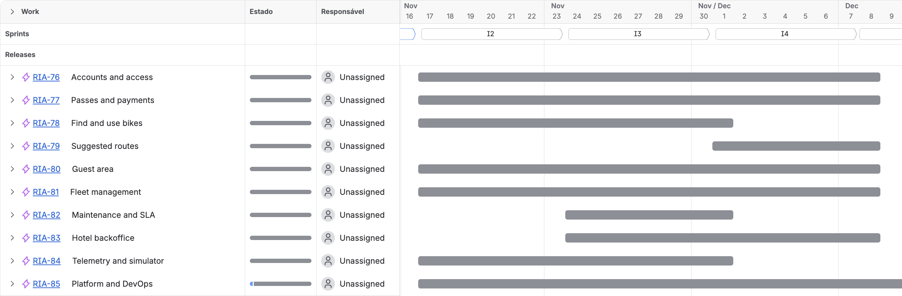

# 2. Product concept and requirements

> Draft for section 2 of the Product Specification report (RIA-16).

## 2.1 Vision statement

Tourists in Vila Ria want to explore the coast, the salt pans and the old town without a car, but short trips are awkward: taxis are expensive, buses are infrequent, and running a fleet is not a hotel's business. Grupo Hoteleiro Marés wants to offer mobility as part of the stay without operating it.

RiaRide connects the three parties. At check-in, the hotel registers the stay and the system generates a **stay code**. With that code, the guest creates an account and buys a **1-day pass**, a **3-day pass** or a **stay pass**, at one base price for the whole hotel chain. The pass is activated on the first trip, and while it is valid the guest can make as many trips as they want, picking up and returning e-bikes at any hub in the network. RodaLeve keeps the fleet available: it registers vehicles and hubs, follows their state from telemetry, and repairs faults within the SLA. The hotel group sets prices and rules of use, publishes suggested routes that start and end at a hotel, and follows KPIs.

Unlike public bike-sharing schemes, RiaRide is tied to a hotel stay: only guests with an active stay can ride, the stay pass follows the stay dates, and the hotel group, not the city, sets the rules. The concept was developed by the team; the Product Owner represents the client and operator perspectives.

## 2.2 Personas and scenarios

**Clara Weber, the guest.** Clara, 34, is a graphic designer from Munich on a five-night holiday at Marés Praia with her partner. She speaks English, not Portuguese, and does everything on her phone. She wants to see the salt pans and the old town at her own pace and dislikes queues and paperwork.

*Scenario 1: a day along the coast.* At check-in, Clara receives her stay code. That evening she creates an account in English with her email, a password and the code, and buys a stay pass; the price and the deposit are charged to her card. The next morning she opens the app, sees two e-bikes with enough battery at the Marés Praia hub and books one. When she unlocks it, her first trip starts and the pass is activated. She follows the suggested route to Salinas and ends the trip at the Salinas hub, which has free slots. Her dashboard shows the trip and no extra charges.

*Scenario 2: a long lunch.* Clara stops for lunch in the old town and keeps the bike for 3 h 20 min. When she ends the trip, the app shows an overtime charge for two 15-minute blocks, taken from the card she used to buy the pass.

*Scenario 3: a full hub.* Back at Marés Praia, the hub has no free slot. The app refuses to end the trip, lists the nearest hubs with a free slot, and the trip continues until she parks at one of them.

**Rui Tavares, the operator technician.** Rui, 41, works for RodaLeve Fleet Services and looks after the Vila Ria fleet. He starts each shift by checking which bikes need attention and moves vehicles between hubs when one fills up.

*Scenario 4: a fault during a trip.* While a guest is riding bike VR-017, its telemetry reports a brake fault. The trip continues, a maintenance ticket with an SLA deadline is opened, and the bike is flagged so that it goes to maintenance when the trip ends. Rui sees the ticket on his dashboard, assigns it to himself, repairs the brake and resolves the ticket. Because the damage was caused by wear, not by the guest, the deposit is refunded normally, and the bike becomes available again.

**Helena Marques, the hotel group manager.** Helena, 52, is the guest-experience manager of Grupo Hoteleiro Marés. She decides what the group offers and reports monthly to the board.

*Scenario 5: preparing the summer season.* Helena opens the backoffice, raises the capacity of the Marés Praia hub, updates the base prices of the three pass types for July, and publishes a sunset route from Marés Centro along the coast and back. At the end of the month she checks utilization, trips per day, and how often RodaLeve met the repair SLA.

## 2.3 Project roadmap and priorities

The product is built in five one-week iterations after a kick-off week. Each epic in Jira groups the stories of one area, and the timeline below shows when each epic is planned (Jira timeline, 15 Nov 2026).

| Epic | Area | Planned iterations |
|---|---|---|
| RIA-76 | Accounts and access | I2 to I4 (17 Nov to 8 Dec) |
| RIA-77 | Passes and payments | I2 to I4 (17 Nov to 8 Dec) |
| RIA-78 | Find and use bikes | I2 to I3 (17 Nov to 1 Dec) |
| RIA-79 | Suggested routes | I4 (1 to 8 Dec) |
| RIA-80 | Guest area | I2 to I4 (17 Nov to 8 Dec) |
| RIA-81 | Fleet management | I2 to I4 (17 Nov to 8 Dec) |
| RIA-82 | Maintenance and SLA | I3 (24 Nov to 1 Dec) |
| RIA-83 | Hotel backoffice | I3 to I4 (24 Nov to 8 Dec) |
| RIA-84 | Telemetry and simulator | I2 to I3 (17 Nov to 1 Dec) |
| RIA-85 | Platform and DevOps | I2 to I5 (from 17 Nov) |

Before the epics start, iteration I1 (10 Nov) delivers the concept, personas and first stories, the architecture proposal, the walking skeleton built by CI and this report as a draft. Iteration I5 (8 Dec) is kept for stabilization, the final reports and the tag `final_v1`.

Priorities follow the business value of the core flow: a guest must be able to register, buy a pass and ride before routes and backoffice features are added. That is why accounts, passes, bikes, fleet and telemetry start in I2, maintenance and the backoffice in I3, and suggested routes last, in I4.
