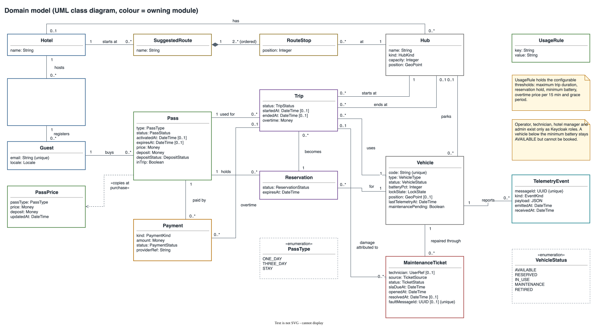
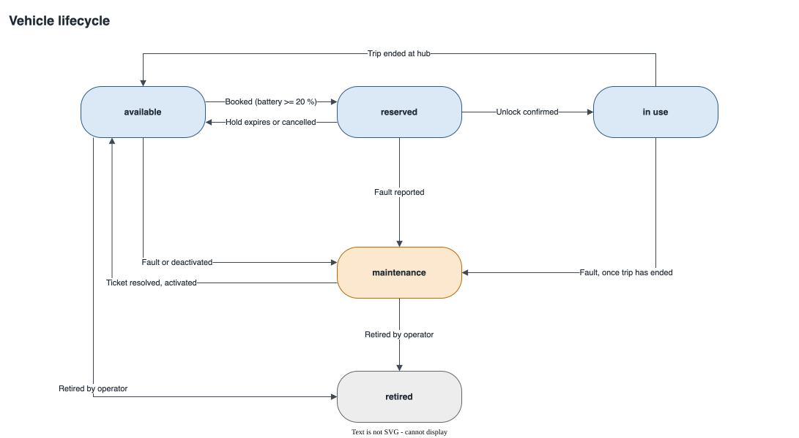

# 3. Domain model

> Draft for section 3 of the Product Specification report (RIA-16). The [architecture proposal](../../architecture/README.md) is the source of truth; this section condenses its sections 5, 6 and 8.

## 3.1 Domain concepts

The class diagram shows the business concepts of RiaRide and how they relate, independent of database tables. The border colour of each class shows the backend module that owns it.

| Module | Concepts | Role in the domain |
|---|---|---|
| `accounts` | Hotel, Stay, Guest | At check-in, the hotel registers a stay, which yields a stay code. A guest registers with that code. |
| `passes` | PassPrice, Pass, UsageRule | A guest buys a pass at the chain's base price. The pass copies the price and deposit at purchase, so later price changes do not affect it. The deposit is refunded when the pass ends, unless a maintenance ticket linked to it is still open or unpaid overtime was taken from it. UsageRule holds the thresholds the hotel manager configures. |
| `payments` | Payment | The purchase, the deposit refund and any overtime charge of a pass. |
| `trips` | Reservation, Trip | A reservation holds a vehicle. It can lead to several trips, because a trip that fails to start leaves the reservation active until it expires. |
| `fleet` | Hub, Vehicle | Hubs at hotels and tourist spots, each with a capacity and a position. Vehicles keep their latest telemetry state. |
| `maintenance` | MaintenanceTicket | One ticket per reported fault, with an SLA deadline and an optional technician. Damage can be attributed to a trip. |
| `telemetry` | TelemetryEvent | Events from the simulator, ignored when a `messageId` repeats. Telemetry older than the vehicle's last state is also ignored; fault events never are. |
| `backoffice` | SuggestedRoute, RouteStop | Routes published by the hotel group: an ordered list of hubs that starts and ends at a hotel. |

Operator, technician, hotel manager and admin are not domain classes. They exist only as roles in the identity provider.

The rules with the highest concurrency risk are enforced by the database:

- A pass has at most one trip in progress.
- A pass has at most one active reservation.
- A vehicle has at most one active reservation.
- A reported fault opens at most one ticket.

A trip ends only at a hub with a free slot. This is not a database constraint: the hub row is locked, its occupancy checked and the trip ended in one transaction, so it needs its own concurrency integration tests.

## 3.2 Business rules

The rules below are the constraints and calculations the product enforces, whatever the interface. Each rule has an ID that is used as a tag in the Gherkin scenarios (for example, `@BR7`) and in Xray, so that every rule can be traced to its tests. The tests are written with each story, from iteration I2. Story numbers refer to section 2.3.

| ID | Rule | Parameters and boundaries | Covered by |
|---|---|---|---|
| BR1 | Only a guest with an active stay can register and book | The stay code is accepted from check-in until check-out; refused before check-in and after check-out | Stories 1.1, 1.2 and 2.1; Gherkin @BR1 (RIA-50, RIA-51); unit and integration tests (RIA-50, RIA-51, RIA-52) |
| BR2 | There are three pass types: 1-day, 3-day and stay | 1-day pass: valid for 24 h after activation; 3-day pass: 72 h after activation (to confirm); stay pass: valid until check-out | Stories 2.1 and 2.2; unit tests @BR2 (planned, I3) |
| BR3 | One base price per pass type is used by all the hotels in the chain | A price change applies only to new purchases; a pass keeps the price it was bought at | Story 2.1: purchase at the base price, Gherkin @BR3 and unit tests (RIA-52); price changes in story 8.1 (planned, I4) |
| BR4 | A pass is activated on its first trip, not at purchase | Validity starts when the unlock of the first trip is confirmed; if the unlock is not confirmed within 30 s, the trip fails and the pass stays inactive | Story 2.1: a bought pass is not active, Gherkin @BR4 (RIA-52); activation on the first trip in stories 2.2 and 3.2 (planned, I3) |
| BR5 | The deposit is charged at purchase and refunded at the end of the pass if there are no problems | Not refunded while a trip is in progress or a maintenance ticket linked to the pass is open | Story 2.1: deposit charged at purchase, Gherkin @BR5, unit tests and integration tests of the payment adapter, including the refund when the pass cannot be stored (RIA-52); refund at the end of the pass in story 2.4 (planned, I4) |
| BR6 | Each pass can have only one vehicle in use at a time | A second trip while one is in progress is refused | Story 3.2; unit tests and Gherkin @BR6 (planned, I3) |
| BR7 | The maximum trip duration is 3 h, or the value a hotel manager sets as a rule of use (RIA-96); beyond it, overtime is charged for each started 15-minute block | 3 h 00 min → 0 blocks; 3 h 01 min → 1 block; 3 h 15 min → 1 block; 3 h 16 min → 2 blocks | Story 2.3; unit tests @BR7 (planned, I3) |
| BR8 | If the pass expires during a trip, the trip continues, and the time after expiry is charged as overtime | Same 15-minute blocks as BR7. Example: pass expires at 15:00, trip ends at 15:30 → 2 blocks | Story 2.5; unit tests @BR8 (planned, I3) |
| BR9 | The stay pass ends at check-out; if the bike has not been returned, the extra time is charged as overtime | Same 15-minute blocks as BR7. Example: check-out at 12:00, trip ends at 12:20 → 2 blocks | Story 2.5; unit tests @BR9 (planned, I3) |
| BR10 | A trip can only end at a hub with a free slot; each hub's capacity is set by the client | Parked bikes < capacity: accepted; parked bikes = capacity: refused, and the nearest hubs with a free slot are listed | Stories 6.1 and 6.2: unit tests, concurrency integration test and Gherkin @BR10 (RIA-56, RIA-57); end of trip in story 3.4 (planned, I3) |
| BR11 | A bike can be booked in advance and is held for 15 minutes | Trip started at 14 min 59 s: accepted; at 15 min 00 s: the reservation expires and the bike becomes available | Story 3.3; unit tests @BR11 (planned, I3) |
| BR12 | A vehicle with battery below 20 % cannot be booked; the battery level comes from telemetry | 19 %: refused; 20 %: accepted | Stories 3.1 and 9.2; unit tests and Gherkin @BR12 (RIA-53, RIA-59) |
| BR13 | A trip whose unlock is not confirmed by telemetry in time fails | Unlock confirmed within 30 s: the trip starts; not confirmed within 30 s: the trip fails, the pass stays inactive and the bike stays reserved until the booking expires (BR11) | Story 3.2; unit tests and Gherkin @BR13 (planned, I3) |

All payments (pass, deposit and overtime) are made by the guest. Invoicing the hotel group is out of scope.

## 3.3 Special lifecycles

| From | To | Trigger |
|---|---|---|
| `available` | `reserved` | A guest books the vehicle, and its battery is at least 20 % |
| `reserved` | `available` | The 15-minute hold expires, or the guest cancels |
| `reserved` | `in use` | Telemetry confirms the unlock |
| `in use` | `available` | The trip ends at a hub with a free slot |
| `in use` | `maintenance` | The trip ends after a fault was reported during it |
| `available` | `maintenance` | A fault is reported, or the operator deactivates the vehicle |
| `reserved` | `maintenance` | A fault is reported; the reservation is cancelled |
| `maintenance` | `available` | The ticket is resolved, or the operator activates the vehicle |
| `available` or `maintenance` | `retired` | The operator retires the vehicle; it never returns to service |

A battery below 20 % blocks booking without changing the status. A vehicle in use cannot be retired. When a fault is reported during a trip, the trip continues: the vehicle is flagged `maintenancePending` and moves to `maintenance` when the trip ends.
