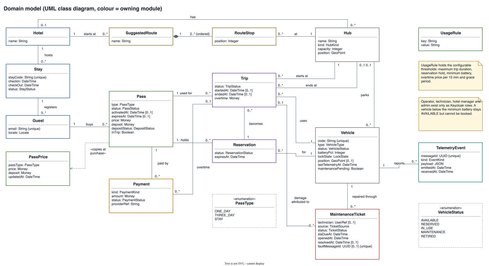
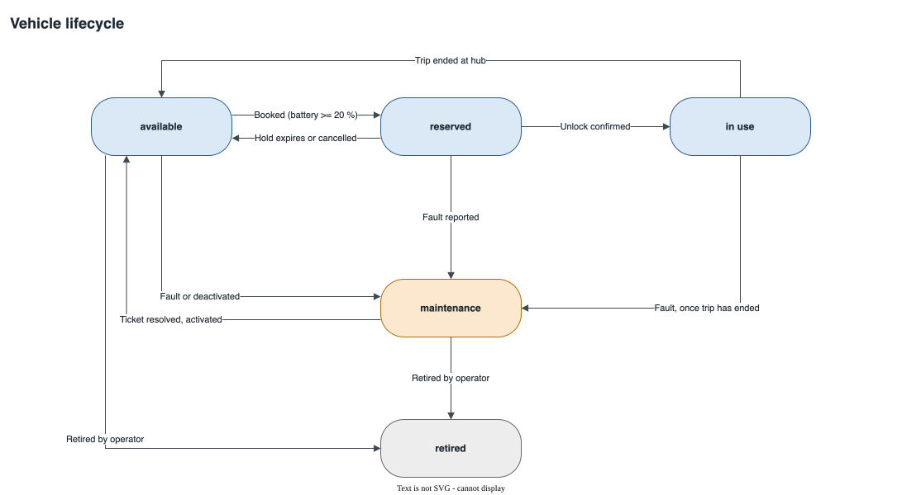

# 3. Domain model

> Draft for section 3 of the Product Specification report (RIA-16). The [architecture proposal](../../architecture/README.md) is the source of truth; this section condenses its sections 5, 6 and 8.

## 3.1 Domain concepts

The class diagram shows the business concepts of RiaRide and how they relate, independent of database tables. The border colour of each class shows the backend module that owns it.

| Module | Concepts | Role in the domain |
|---|---|---|
| `accounts` | Hotel, Stay, Guest | At check-in, the hotel registers a stay, which yields a stay code. A guest registers with that code. |
| `passes` | PassPrice, Pass, UsageRule | A guest buys a pass at the chain's base price. The pass copies the price and deposit at purchase, so later price changes do not affect it. UsageRule holds the thresholds the hotel manager configures. |
| `payments` | Payment | The purchase, the deposit refund and any overtime charge of a pass. |
| `trips` | Reservation, Trip | A reservation holds a vehicle. It can lead to several trips, because a trip that fails to start leaves the reservation active until it expires. |
| `fleet` | Hub, Vehicle | Hubs at hotels and tourist spots, each with a capacity and a position. Vehicles keep their latest telemetry state. |
| `maintenance` | MaintenanceTicket | One ticket per reported fault, with an SLA deadline and an optional technician. Damage can be attributed to a trip. |
| `telemetry` | TelemetryEvent | Events from the simulator, ignored when a `messageId` repeats. |
| `backoffice` | SuggestedRoute, RouteStop | Routes published by the hotel group: an ordered list of hubs that starts at a hotel. |

Operator, technician, hotel manager and admin are not domain classes. They exist only as roles in the identity provider.

The rules with the highest concurrency risk are enforced by the database:

- A pass has at most one trip in progress.
- A vehicle has at most one active reservation.
- A trip ends only at a hub with a free slot.
- A reported fault opens at most one ticket.

## 3.2 Vehicle lifecycle

| From | To | Trigger |
|---|---|---|
| `available` | `reserved` | A guest books the vehicle, and its battery is at least 20 % |
| `reserved` | `available` | The 15-minute hold expires, or the guest cancels |
| `reserved` | `in use` | Telemetry confirms the unlock |
| `in use` | `available` | The trip ends at a hub with a free slot |
| `in use` | `maintenance` | The trip ends after a fault was reported during it |
| `available` | `maintenance` | A fault is reported, or the operator deactivates the vehicle |
| `reserved` | `maintenance` | A fault is reported; the reservation is cancelled |
| `maintenance` | `available` | The ticket is resolved, or the operator activates the vehicle |
| `available` or `maintenance` | `retired` | The operator retires the vehicle; it never returns to service |

A battery below 20 % blocks booking without changing the status. A vehicle in use cannot be retired. When a fault is reported during a trip, the trip continues: the vehicle is flagged `maintenancePending` and moves to `maintenance` when the trip ends.
