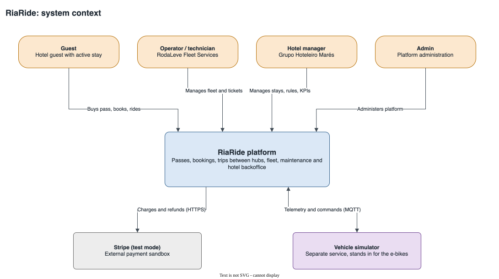
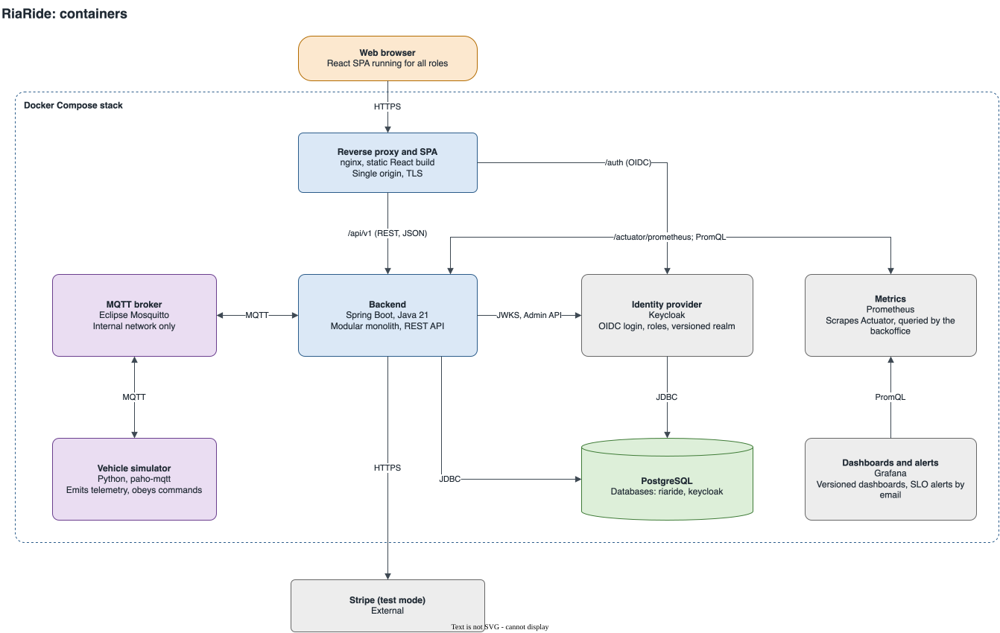
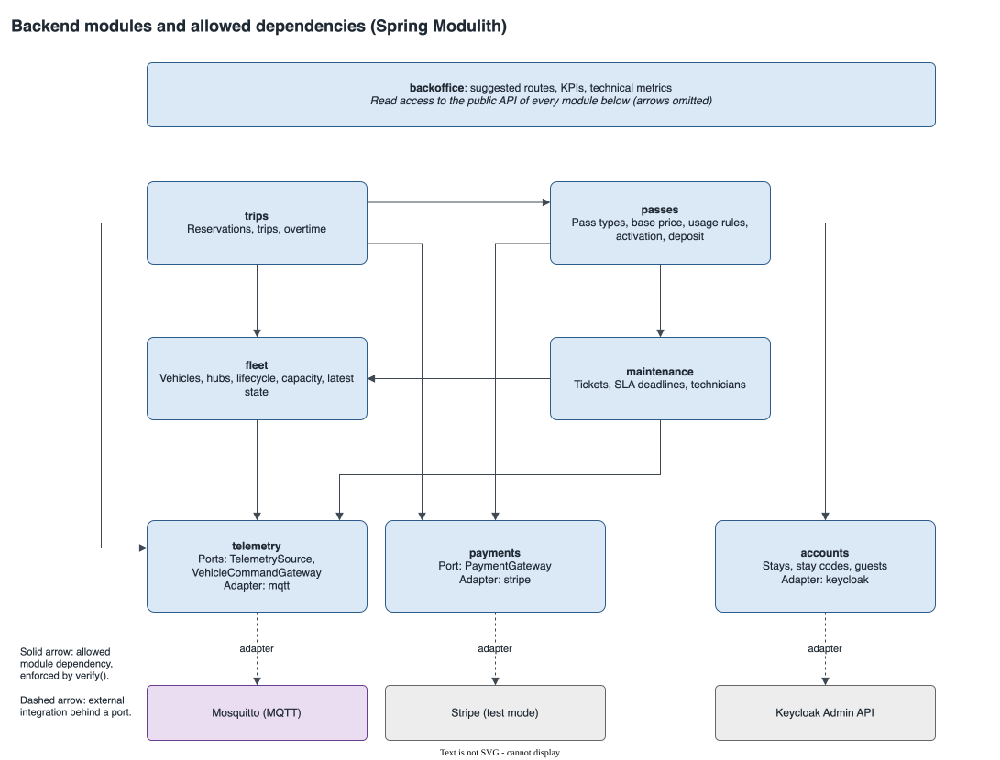
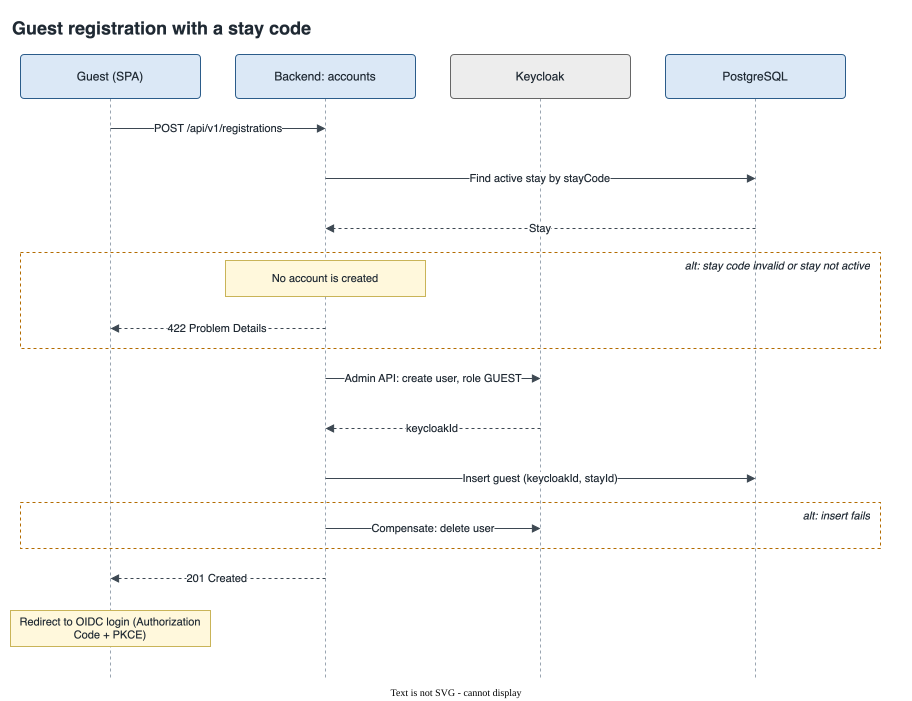
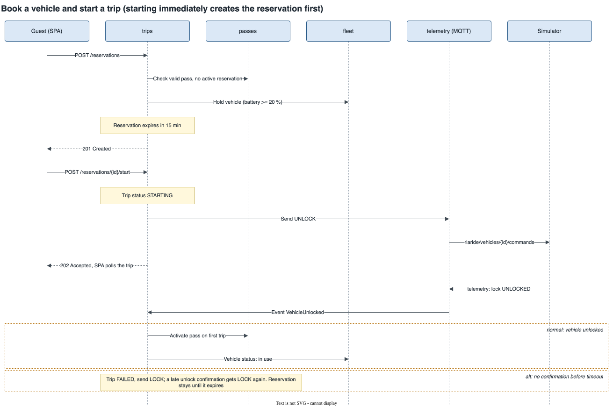
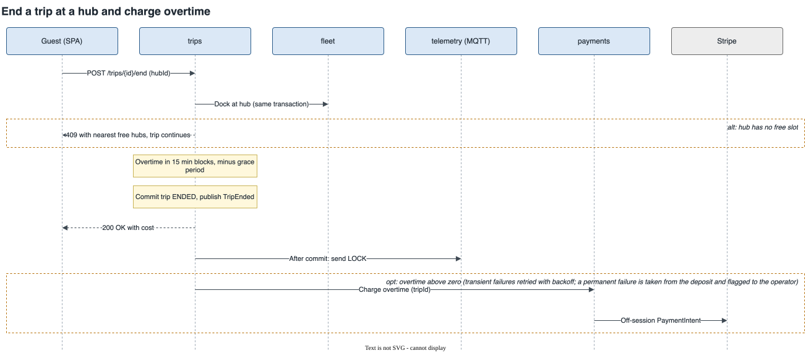
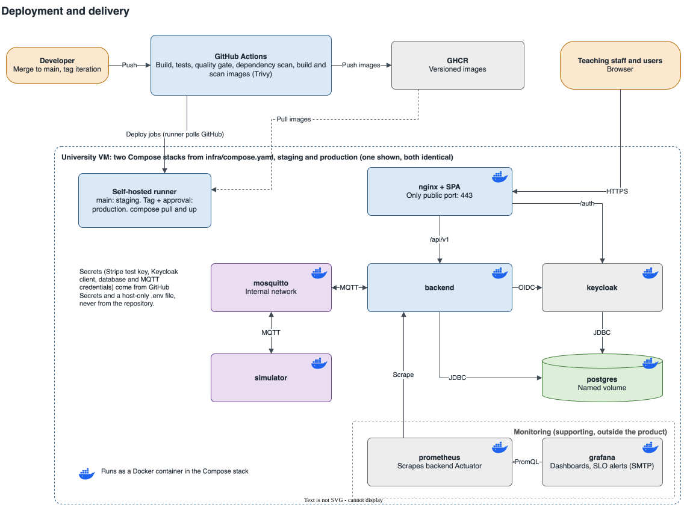

# 4. Architecture

> Draft for section 4 of the Product Specification report (RIA-16). The [architecture proposal](../../architecture/README.md) is the source of truth, and each decision has a record in [`adr/`](../../architecture/adr/). This section condenses them.

## 4.1 Key requirements and constraints

- **Fixed stack:** Spring Boot and Java 21 for the backend; a responsive web UI.
- **Telemetry:** the fleet simulator runs as a separate service, read through one interface behind an adapter. Replacing the simulator changes only that adapter.
- **Payments:** a payment sandbox behind an adapter, covered by integration tests.
- **Delivery:** production is described as code, and `main` deploys automatically, with representative data, to an environment the teaching staff can reach.
- **Evidence of quality:** module boundaries, adapters and flows must be testable in isolation, and the quality gate must block merges.
- **Team size:** four people and five weeks call for one deployable and few moving parts.

The [traceability table](../../architecture/README.md#traceability-to-the-assignment) maps each requirement of the assignment guidelines to where the architecture answers it. Three gaps are open questions for the Product Owner: booking for a period, who may use which vehicles, and problem reports by end users.

## 4.2 Non-functional requirements and SLOs

*Proposed by the QA Engineer and confirmed by the team (RIA-163).*

The SLOs cover what a guest notices first (booking speed and failures), what the fleet depends on (fresh telemetry) and whether the service is up. Each one is measured from the backend's own metrics, so the alerts and the tests use the same numbers.

| ID | Objective | Metric and target | Verified by |
|---|---|---|---|
| SLO1 | Booking and starting a trip is fast at peak load | p95 latency of the book and start requests < 500 ms with 50 concurrent virtual users | k6 load scenario with thresholds, before each tag from I4 (QA Manual, section 5.4); Grafana alert in production |
| SLO2 | The API rarely fails | Server errors (5xx) < 1 % of requests; business rejections (4xx) do not count | k6 `http_req_failed` threshold in the same run, with `http.setResponseCallback(http.expectedStatuses({ min: 200, max: 499 }))` so only 5xx count as failed; Grafana alert on the 5xx rate in production |
| SLO3 | Telemetry is processed promptly | p95 of the telemetry lag (`received_at` minus `emitted_at`) < 5 s with the simulator emitting 10 readings per second | Simulator run at that rate on staging, read from the Micrometer telemetry lag metric; Grafana alert in production |
| SLO4 | The service is available | 99 % of health checks succeed per week | Prometheus probing `/actuator/health` on staging and production; Grafana uptime panel and alert |

The alert rules for each SLO are in the QA Manual, section 4.3. SLO4 is measurable from the first deployment in I3; SLO1 to SLO3 need the k6 scripts and the simulator, so they are first measured in I4.

Other non-functional requirements already have a fixed target and an automated check:

- **Accessibility:** no `serious` or `critical` axe violations on the core pages, in both languages (Playwright suite).
- **Security:** no unresolved HIGH or CRITICAL dependency finding (OWASP Dependency-Check failing at CVSS ≥ 7, `npm audit`, `pip-audit`, Trivy on images).
- **Maintainability:** the SonarQube quality gate on new code (coverage ≥ 80 %, duplication ≤ 3 %, A ratings, all hotspots reviewed) blocks the merge.

## 4.3 Architectural view

Guests, RodaLeve operators and technicians, Marés hotel managers and admins use one web application. Stripe test mode processes payments, and the simulator stands in for the e-bikes.

Each box with the Docker icon runs as its own container in the Compose stack; the browser and Stripe do not.

| Container | Technology | Responsibility |
|---|---|---|
| Reverse proxy and SPA | nginx, React build | Single public origin, TLS, routes `/api/v1`, `/auth` and `/grafana` |
| Backend | Spring Boot, Java 21 | All business logic, REST API, OAuth2 resource server |
| PostgreSQL | One server | Databases `riaride` and `keycloak` |
| Keycloak | OIDC provider | Credentials, login pages, roles |
| Mosquitto | MQTT broker | Telemetry and commands, internal network only |
| Simulator | Python, paho-mqtt | Stands in for the e-bikes: emits telemetry per vehicle, reacts to commands |
| Prometheus *(monitoring)* | Metrics store | Scrapes the backend's Actuator metrics; the backoffice reads technical metrics from it |
| Grafana *(monitoring)* | Dashboards and alerts | Dashboards and SLO alerts by email |

Prometheus and Grafana run in the same Compose project but outside the system boundary: they observe RiaRide, and no user flow depends on them. If Prometheus is down, only the backoffice's technical metrics are unavailable.

The backend is a modular monolith ([ADR 0001](../../architecture/adr/0001-modular-monolith.md)). Spring Modulith checks the allowed dependencies in a test that fails the build on a violation ([ADR 0002](../../architecture/adr/0002-spring-modulith.md)). Ports and adapters are used only at the external integrations: `telemetry` for MQTT, `payments` for Stripe and `accounts` for Keycloak.

Requests enter through the REST controllers, protected by Spring Security, and reach the business modules. Modules reach PostgreSQL through JPA repositories, and Keycloak, Mosquitto and Stripe only through their adapters. Inside, every module has the same layers: controller, service, domain and repository; only its top-level package is public.

## 4.4 Module interactions

A module calls another module's public API for queries and for commands whose result it needs now. For side effects elsewhere, it publishes an event, handled after commit. Spring Modulith stores each event in PostgreSQL until its listener succeeds, so a crash does not lose a refund or an overtime charge. A pass that ends during a trip closes only when that trip ends. Its deposit is refunded only when no trip is waiting for its overtime and no maintenance ticket linked to it is open.

**Guest registration.** The backend checks the stay code, creates the user through the Keycloak Admin API, and deletes that user if the local insert fails.

The sign-up request is `POST /api/v1/guests`.

**Booking and starting a trip.** Starting immediately creates a reservation first, so there is one code path. The trip stays `STARTING` until telemetry confirms the unlock. Without confirmation before the timeout, the trip fails, the platform sends `LOCK` in case the vehicle did unlock, and the pass stays inactive. A late unlock confirmation for a failed trip gets another `LOCK`. A pass holds at most one active reservation.

**Ending a trip.** A full hub rejects the end of the trip and lists the nearest hubs with a free slot. Overtime is the time beyond the earliest of the maximum trip duration, the pass expiry and check-out, in 15-minute blocks. It is charged after commit, so a Stripe outage does not stop a guest from ending a trip. Transient failures are retried with backoff. A permanent failure, such as a declined card, is taken from the deposit and flagged on the operator dashboard.

**Faults.** `maintenance` opens one ticket per fault. `fleet` takes the vehicle out of service, or flags it `maintenancePending` while a trip is in progress. `trips` cancels the vehicle's reservation, or attaches the trip to the ticket so that damage can be charged against the deposit. The deposit stays held until the ticket is resolved. Fault events are deduplicated by `messageId` but never dropped as stale, because MQTT does not order messages across topics.

## 4.5 Deployment

A merge to `main` builds and tests in GitHub Actions, pushes versioned images to GHCR and deploys them to a staging Compose stack on the university VM, through a self-hosted runner. An iteration tag promotes the same images to production after a manual approval ([ADR 0011](../../architecture/adr/0011-deployment.md)). The only public port is 443. Secrets come from GitHub Secrets and a host-only `.env` file. The local development stack ([`infra/compose.yaml`](../../../infra/compose.yaml)) already runs PostgreSQL, Keycloak, Mosquitto and the simulator.

## 4.6 Integration contracts

**MQTT** ([ADR 0006](../../architecture/adr/0006-mqtt-integration.md)). Both directions use QoS 1, and the consumer ignores repeated or out-of-order messages.

| Topic | Direction | Content |
|---|---|---|
| `riaride/vehicles/{id}/telemetry` | Simulator to platform | Battery, position or hub, lock state |
| `riaride/vehicles/{id}/events` | Simulator to platform | Fault events |
| `riaride/vehicles/{id}/commands` | Platform to simulator | `UNLOCK`, `LOCK` |
| `riaride/simulator/status` | Simulator to platform | Retained status and last will |

The message formats are JSON Schemas in [`contracts/mqtt/`](../../../contracts/mqtt/), shared by the simulator and the backend adapter. `{id}` in the topics is the vehicle code (for example, `EB-101`), not the platform's vehicle id. `hubId` is the platform's hub id, so the simulator's demo fleet uses the same hub ids as the seed data. `hubId` is optional on `LOCK`: without it, the vehicle locks where it is. Every command carries `emittedAt`, and the simulator ignores a command older than 30 s (BR13), so an `UNLOCK` the platform already gave up on is not applied when the simulator reconnects.

**Payments** ([ADR 0008](../../architecture/adr/0008-stripe-test-mode.md)). `PaymentGateway` offers charges and refunds, each with an idempotency key. The purchase saves the payment method in Stripe, and overtime is charged to it off-session.

**REST.** Versioned under `/api/v1` and documented with OpenAPI. Errors use RFC 9457 Problem Details.
