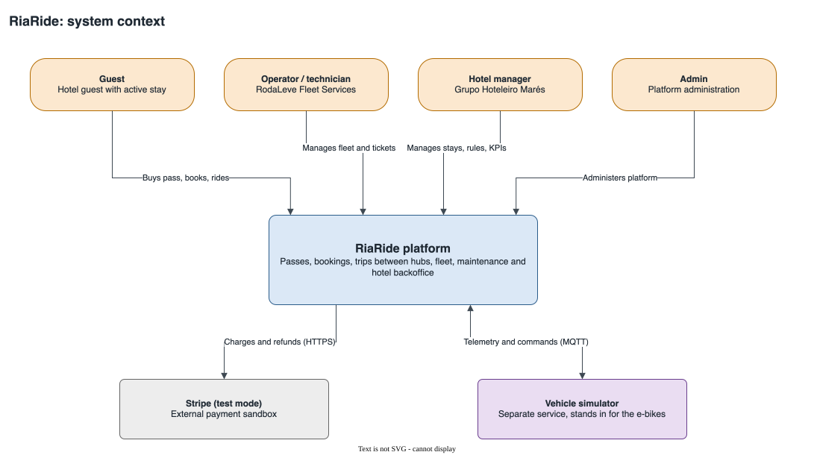
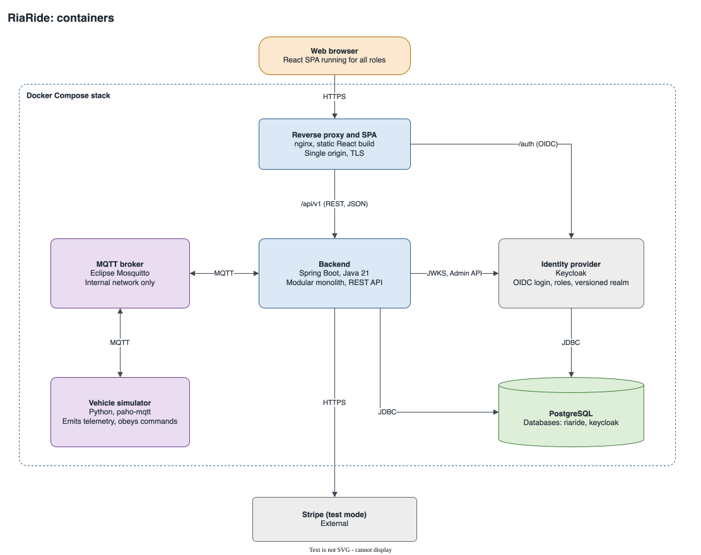
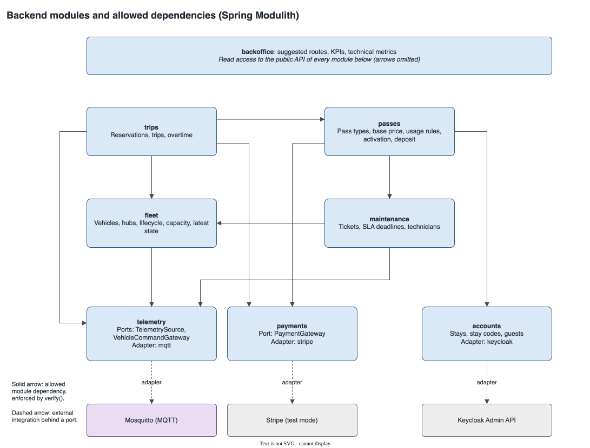
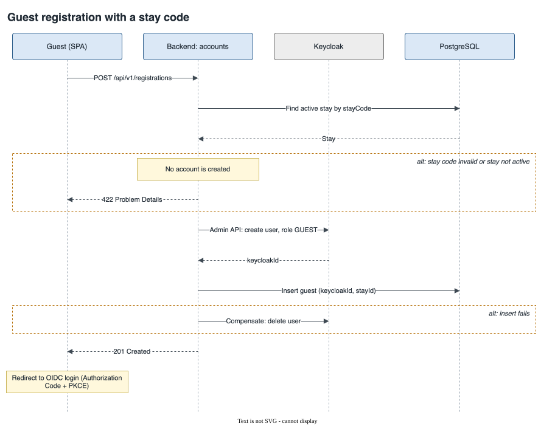
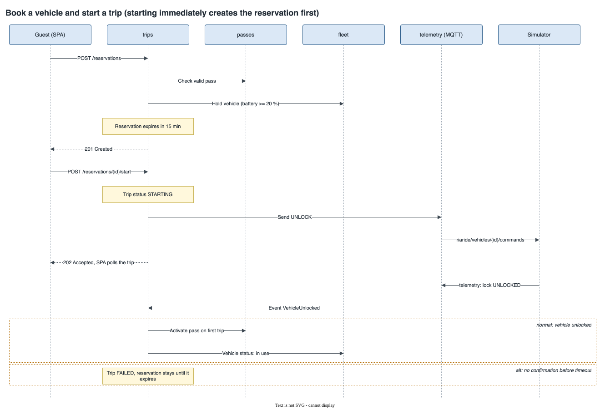
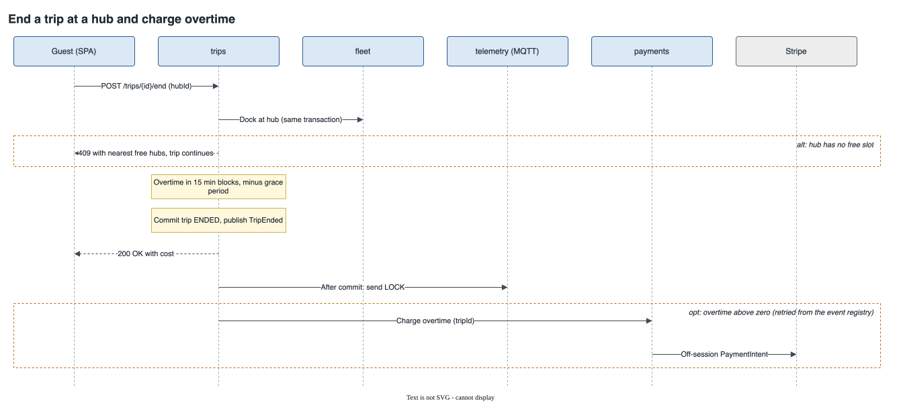
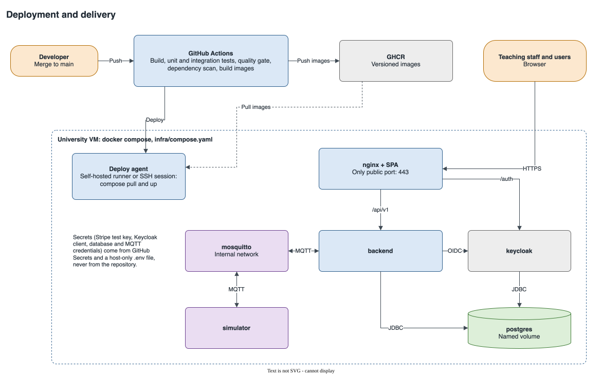

# 4. Architecture

> Draft for section 4 of the Product Specification report (RIA-16). The [architecture proposal](../../architecture/README.md) is the source of truth, and each decision has a record in [`adr/`](../../architecture/adr/). This section condenses them.

## 4.1 Key requirements and constraints

- **Fixed stack:** Spring Boot and Java 21 for the backend; a responsive web UI.
- **Telemetry:** the fleet simulator runs as a separate service, read through one interface behind an adapter. Replacing the simulator changes only that adapter.
- **Payments:** a payment sandbox behind an adapter, covered by integration tests.
- **Delivery:** production is described as code, and `main` deploys automatically, with representative data, to an environment the teaching staff can reach.
- **Evidence of quality:** module boundaries, adapters and flows must be testable in isolation, and the quality gate must block merges.
- **Team size:** four people and five weeks call for one deployable and few moving parts.

The [traceability table](../../architecture/README.md#traceability-to-the-assignment) maps each requirement of the assignment guidelines to where the architecture answers it. Three gaps are open questions for the Product Owner: booking for a period, who may use which vehicles, and problem reports by end users.

## 4.2 Architectural view

Guests, RodaLeve operators and technicians, Marés hotel managers and admins use one web application. Stripe test mode processes payments, and the simulator stands in for the e-bikes.

| Container | Technology | Responsibility |
|---|---|---|
| Reverse proxy and SPA | nginx, React build | Single public origin, TLS, routes `/api/v1` and `/auth` |
| Backend | Spring Boot, Java 21 | All business logic, REST API, OAuth2 resource server |
| PostgreSQL | One server | Databases `riaride` and `keycloak` |
| Keycloak | OIDC provider | Credentials, login pages, roles |
| Mosquitto | MQTT broker | Telemetry and commands, internal network only |
| Simulator | Python, paho-mqtt | Emits telemetry per vehicle, reacts to commands |

The backend is a modular monolith ([ADR 0001](../../architecture/adr/0001-modular-monolith.md)). Spring Modulith checks the allowed dependencies in a test that fails the build on a violation ([ADR 0002](../../architecture/adr/0002-spring-modulith.md)). Ports and adapters are used only at the external integrations: `telemetry` for MQTT, `payments` for Stripe and `accounts` for Keycloak.

## 4.3 Module interactions

A module calls another module's public API for queries and for commands whose result it needs now. For side effects elsewhere, it publishes an event, handled after commit. Spring Modulith stores each event in PostgreSQL until its listener succeeds, so a crash does not lose a refund or an overtime charge.

**Guest registration.** The backend checks the stay code, creates the user through the Keycloak Admin API, and deletes that user if the local insert fails.

**Booking and starting a trip.** Starting immediately creates a reservation first, so there is one code path. The trip stays `STARTING` until telemetry confirms the unlock. Without confirmation before the timeout, the trip fails and the pass stays inactive.

**Ending a trip.** A full hub rejects the end of the trip and lists the nearest hubs with a free slot. Overtime is the time beyond the earliest of the maximum trip duration, the pass expiry and check-out, in 15-minute blocks. It is charged after commit, so a Stripe outage does not stop a guest from ending a trip.

**Faults.** `maintenance` opens one ticket per fault. `fleet` takes the vehicle out of service, or flags it `maintenancePending` while a trip is in progress. `trips` cancels the vehicle's reservation, or attaches the trip to the ticket so that damage can be charged against the deposit.

## 4.4 Deployment

A merge to `main` builds and tests in GitHub Actions, pushes versioned images to GHCR and updates the university VM with Docker Compose ([ADR 0011](../../architecture/adr/0011-deployment.md)). The only public port is 443. Secrets come from GitHub Secrets and a host-only `.env` file.

## 4.5 Integration contracts

**MQTT** ([ADR 0006](../../architecture/adr/0006-mqtt-integration.md)). Both directions use QoS 1, and the consumer ignores repeated or out-of-order messages.

| Topic | Direction | Content |
|---|---|---|
| `riaride/vehicles/{id}/telemetry` | Simulator to platform | Battery, position or hub, lock state |
| `riaride/vehicles/{id}/events` | Simulator to platform | Fault events |
| `riaride/vehicles/{id}/commands` | Platform to simulator | `UNLOCK`, `LOCK` |
| `riaride/simulator/status` | Simulator to platform | Retained status and last will |

**Payments** ([ADR 0008](../../architecture/adr/0008-stripe-test-mode.md)). `PaymentGateway` offers charges and refunds, each with an idempotency key. The purchase saves the payment method in Stripe, and overtime is charged to it off-session.

**REST.** Versioned under `/api/v1` and documented with OpenAPI. Errors use RFC 9457 Problem Details.
